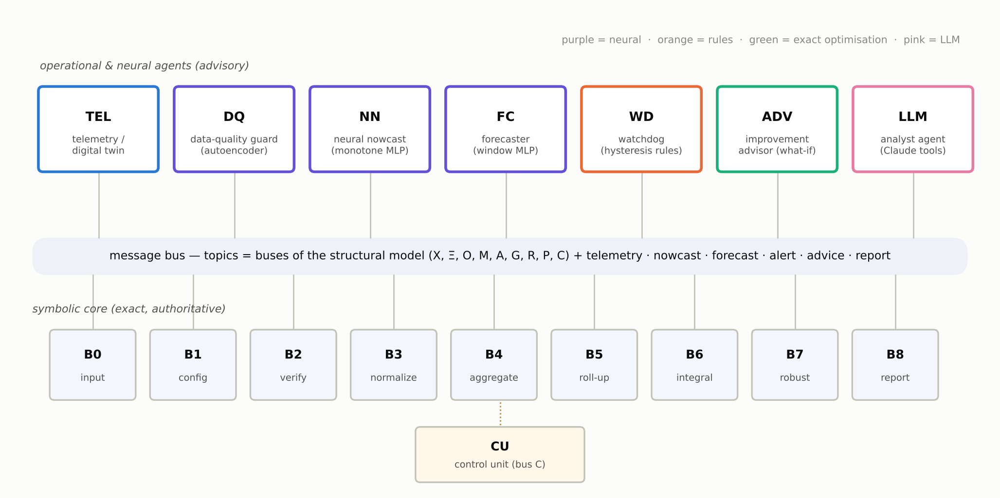
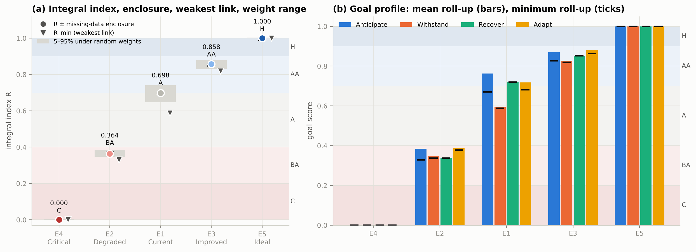
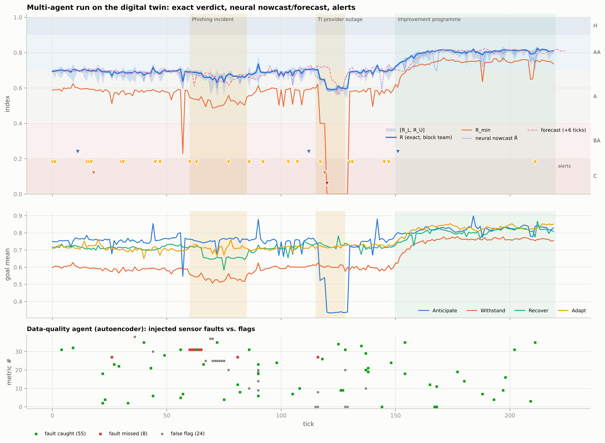

# CRTM-OIS 1.0 — agent-oriented system for the integral cyber resilience of critical infrastructure objects

Software, data and reproduction scripts for the article *"A Staged Method and System for Computing the Integral Cyber
Resilience of Critical Infrastructure Objects: A Systems Approach Based on a Set-Theoretic Tuple Metric Model"*
(submitted to *Systems*, MDPI). CRTM-OIS stands for *cyber-resilience tuple model, object integral score*.

The software has three layers:

1. **Exact symbolic core** (`crtm_ois/system.py`, `core.py`): the seven-stage method Φ, blocks B0–B8, the control
   unit CU, nine buses, failure codes E1–E4 and the trace register. It reproduces every published number of the article.
2. **Agent layer** (`crtm_ois/agents/`): the structural model runs as a team of agents on a message bus
   (block = agent, bus = topic). Around it work agents for digital-twin telemetry, data quality, forecasting,
   monitoring and improvement advice, plus an LLM analyst with tools for Claude.
3. **Neural components** (`crtm_ois/neural/`, NumPy only): a monotone neural surrogate, a data-quality autoencoder,
   a window forecaster and a differentiable calibration of goal weights against expert levels.

The neural and LLM components are advisory. The verdict is issued by the exact system; the veto and cap of Stage 4 are
never replaced by a learned function.

## Quick start

```bash
pip install -r requirements.txt           # numpy, matplotlib (+ optional anthropic, nbclient, pytest)
python -m pytest -q                        # 17 tests
python -m crtm_ois.cli assess E1           # verdict for state E1 (JSON)
python -m crtm_ois.cli report E2           # offline analyst report
python scripts/make_figures.py             # all figures -> figures/, numbers -> results/   (~1 min)
python scripts/export_data.py              # input data -> data/
python scripts/build_notebook.py           # re-execute the demonstration notebook
jupyter notebook notebooks/CRTM_OIS_demo.ipynb
```

```python
from crtm_ois import bnk_pay, five_states, assess
cfg = bnk_pay()
r = assess(cfg, five_states(cfg)["E1"])
r.R["R"], r.R["level_code"], r.R["R_min"], (r.R["R_L"], r.R["R_U"]), r.P["shares"]
# (0.6983, 'A', 0.5885, (0.6909, 0.7034), {'A': 0.544, 'AA': 0.456, ...})
```

Tested with Python 3.13, NumPy 2.5, Matplotlib 3.11 (Linux). The core needs only NumPy; Matplotlib is needed for
figures, `anthropic` only for the Claude analyst, `nbclient`/`ipykernel` only to re-execute the notebook.

## Reproduction of the article

| Check | Article | CRTM-OIS |
|---|---|---|
| 15 published CRTM values (Table 5), tolerance 0.0005 | 15/15 | **15/15**; enclosure of CN.S2.A1 [0.539, 0.639] ✓ |
| E1 / E2 / E3 / E4 / E5: R and level | 0.698 A / 0.364 BA / 0.858 AA / 0 C / 1 H | **0.698 A / 0.364 BA / 0.858 AA / 0 C / 1 H** |
| Enclosure of R in E1 | [0.691, 0.703] | **[0.691, 0.703]** (crosses 0.7) |
| Level shares of E1, Dirichlet(1), 200,000 samples | A 54.4 %, AA 45.6 % | **A 54.4 %, AA 45.6 %** |
| R̄ ± sd for E1 / E2 / E3 | 0.696±0.028 / 0.366±0.011 / 0.855±0.015 | **identical** |
| ρ = 4, E1 | A 59.8 %, AA 40.2 % | A 60.1 %, AA 39.9 % (within Monte Carlo error) |
| Boundary crossings along the sweep of t | −0.42, 0.005, 0.645 | **−0.420, 0.005, 0.645**; R and R_min monotone |
| Non-compensation: additive / hard gate / capped at 0 and 1 source | 0.606 / 0 / 0; 0.656 / 0.656 / 0.400 | **identical**; R = 0.591, R_min = 0 |
| Vetoes in E4 | UN.S1.A1, CN.S1.A1, CN.S2.A1 | **identical** |
| Stages 1–6 per run | 0.2–0.3 ms | ≈1.3 ms (this implementation also builds the full trace and hashes the configuration on every run) |

**Note on Table A1.** For state E2, rule (12) gives 102.5 and 142.5 min for UN.S1.A1 M3/M4, whereas Table A1 lists
102 and 142 (Table 6 is computed from 102/142). The other 154 values of E2–E5 agree with the rule. The published table
is used by default (`five_states(cfg, source="table")`); `source="rule"` regenerates the states by the rule. The effect
on R(E2) is below 0.0002. See `compare_rule_with_table` and `data/state_parameters.json`.

## Agent architecture



| Agent | Role | Kind |
|---|---|---|
| `B0`–`B8`, `CU` | blocks of the structural model; a block fires when all input buses of a run have arrived | exact |
| `TEL` | telemetry of a synthetic digital twin (phishing incident, TI provider outage, improvement programme, sensor faults) | simulation |
| `DQ` | autoencoder + persistence rule for core metrics: a fault becomes a missing value (enclosure) or the last validated value is held | neural + rule |
| `NN` | monotone neural surrogate: instant nowcast R̂ | neural |
| `FC` | forecast of R six ticks ahead from a window of buses R and G | neural |
| `WD` | watchdog: level change (with hysteresis), veto, instability w.r.t. missing data and weights, forecast drop | rules |
| `ADV` | exact what-if on physical measurements (the shared AM-DA-1 moves two actions), greedy plan to a stable level | exact optimisation |
| LLM | `ResilienceToolbox` (6 tools with JSON schemas) + `ClaudeAnalyst` (Claude API tool runner) / `OfflineAnalyst` | LLM |

The agent team gives the same R as `assess` to within 1e-12; a failure in B2 (e.g. E3) stops the chain.

### LLM analyst

```bash
pip install anthropic && export ANTHROPIC_API_KEY=...     # or `ant auth login`
python -m crtm_ois.cli ask "Is the verdict for E1 stable, and what should be improved first?"
```

`ClaudeAnalyst` uses `client.beta.messages.tool_runner` with model `claude-opus-5-5`, adaptive thinking and server-side
refusal fallbacks. The agent loop runs locally because the tools operate on in-memory data. The system prompt forbids
estimating numbers: every value in the answer comes from a tool, i.e. from the exact system. The Claude call was not
exercised in the release tests (no API key); `OfflineAnalyst` uses the same tools without network access.

## Neural components (results of `scripts/make_figures.py`)

| Component | Result |
|---|---|
| Monotone surrogate (39→64→32→2, weights softplus ≥ 0) | MAE(R) 0.013, level accuracy 94.7 %, **0 % monotonicity violations** |
| Unconstrained MLP of the same shape | MAE(R) 0.011, level accuracy 95.7 %, 3.4 % monotonicity violations |
| Both on the boundary state E1 (R = 0.698) | predict AA instead of A, which is why the exact system keeps the verdict |
| Autoencoder + persistence rule (220 ticks, 63 injected faults) | recall 87 %, precision 70 %; false vetoes caused by sensor glitches removed |
| Forecast six ticks ahead | MAE 0.018 |
| Goal-weight calibration on a synthetic panel (hidden ω = 0.15/0.40/0.30/0.15) | ω̂ = 0.14/0.41/0.30/0.16; weighted κ 0.71 → 0.83 |

## Figures (`figures/`)

| | |
|---|---|
| `fig01` seven stages of the method and their buses | `fig02` structural model B0–B8, CU |
| `fig03` hierarchy object → goals → actions → metrics (E1) | `fig04` heat map of 39 metrics × 5 states |
| `fig05` adequacy: R, enclosure, R_min, weight range; goal profile | `fig06` action scores; sweep of t |
| `fig07` distribution of R under random weights; non-compensation | `fig08` anchored vs. min–max normalization |
| `fig09` radar of the goal profile | `fig10` neural surrogate: training, parity, level confusion, monotonicity |
| `fig11` agent topology | `fig12` message sequence chart of one run |
| `fig13` digital-twin dashboard: R, enclosure, nowcast, forecast, alerts, sensor faults | `fig14` advisor: what-if and plan |
| `fig15` calibration of goal weights | |




## Contents of the archive

```
crtm-ois-1.0.0/
├── crtm_ois/
│   ├── levels.py, model.py, core.py      # level map (1), descriptors, operators (4)–(10)
│   ├── system.py                          # stages 1–7, blocks B0–B8, CU, buses, E1–E4, trace
│   ├── scenarios.py                       # BNK_PAY, Table A1, rule (12), reference values
│   ├── experiments.py                     # Section 3: reproduction, E1–E5, sweep, robustness, non-compensation, cost
│   ├── fast.py                            # vectorised evaluator of stages 3–6 (= assess to 1e-12)
│   ├── agents/  bus.py blocks.py twin.py ops.py advisor.py llm.py
│   ├── neural/  nn.py (NumPy MLP, Adam, monotone mode), models.py
│   ├── viz/     style.py diagrams.py charts.py
│   └── cli.py
├── data/          # Data S1: metric catalog, inputs E1–E5, reference values (CSV/JSON)
├── results/       # results.json (Section 3), agents_neural.json (agents and neural components)
├── figures/       # 15 PNG figures, 200 dpi
├── notebooks/CRTM_OIS_demo.ipynb          # executed demonstration notebook
├── scripts/       # make_figures.py, export_data.py, build_notebook.py
├── tests/test_crtm_ois.py
├── README.md, CHANGELOG.md, CITATION.cff, .zenodo.json, LICENSE, LICENSE-DATA
└── pyproject.toml, requirements.txt
```

Random seeds are fixed (Monte Carlo seed 20261122; neural and twin seeds in the scripts), so the scripts regenerate the
stored results. Neural training results can differ in the last digits across NumPy/BLAS builds.

## Limitations

The scenario data are illustrative (CRTM [37]); states E2–E5 are constructed by a rule; the digital twin, the sensor
faults and the expert panel are synthetic. The results verify the implementation of the method on one configuration.
The validity of verdicts for real objects requires field data and independent experts. The prototype has no
authentication, access control or persistent storage of the trace.

## How to cite

Please cite the article and this software (see `CITATION.cff`), as well as the underlying model:
Korchenko, O. et al. A Set-Theoretic Tuple Model with Level-Consistent Normalization and Non-Compensatory Aggregation
for Assessing the Cyber Resilience of Critical Infrastructure. *Information* 2026, 17, 1170.
https://doi.org/10.3390/info17111170

## License

Code: MIT (`LICENSE`). Data, results and figures: CC BY 4.0 (`LICENSE-DATA`).

Generative AI (Claude, Anthropic) was used to write parts of the code and documentation. All numbers, tables and
figures were regenerated by the scripts and checked by the automated tests.
