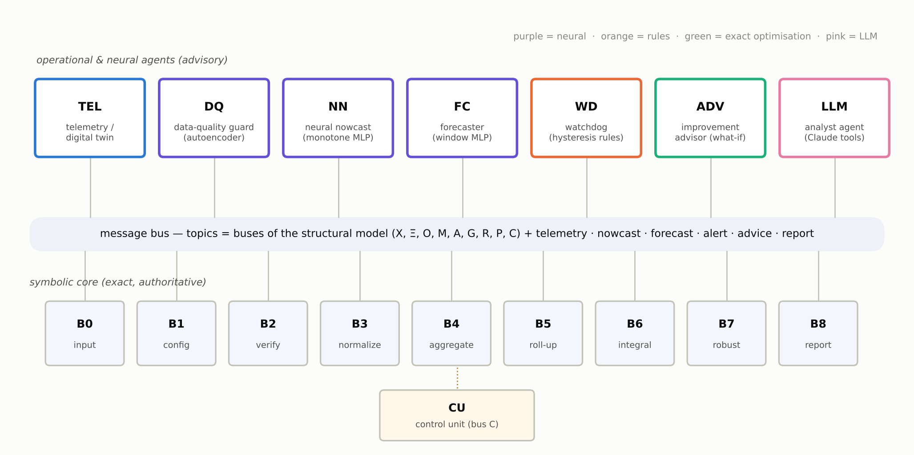
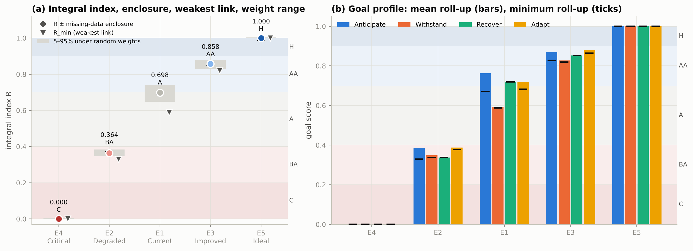
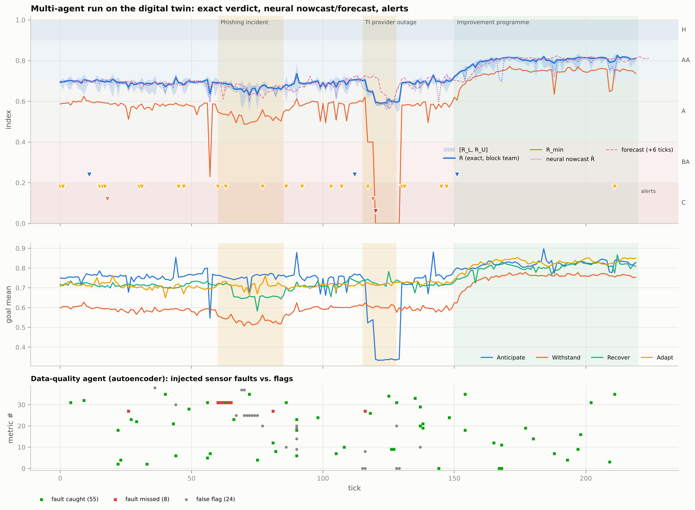

# CRTM-OIS — агентно-орієнтована система оцінювання інтегральної кіберстійкості об’єкта КІ

[](https://doi.org/10.5281/zenodo.24446089)

Програмний проєкт за рукописом *«A Staged Method and System for Computing the Integral Cyber Resilience of Critical
Infrastructure Objects: A Systems Approach Based on a Set-Theoretic Tuple Metric Model»* (подання в *Systems*, MDPI).

Проєкт має три шари:

1. **Точне символьне ядро** (`crtm_ois/system.py`, `core.py`): семиетапний метод Φ, блоки B0–B8, керувальний блок CU,
   дев’ять шин, коди відмов E1–E4 і реєстр трасування. Ядро відтворює всі опубліковані числа статті.
2. **Агентний шар** (`crtm_ois/agents/`): структурна модель реалізована як команда агентів на шині повідомлень
   (блок = агент, шина = топік). Навколо неї працюють агенти телеметрії й цифрового двійника, якості даних, прогнозу,
   сторожа, радника, а також LLM-аналітик з інструментами для Claude.
3. **Нейрорішення** (`crtm_ois/neural/`, лише NumPy): монотонний нейросурогат, автоенкодер якості даних,
   віконний прогнозувальник і диференційовне калібрування ваг цілей за експертними рівнями.

Нейронні та LLM-компоненти лише дорадчі. Вердикт видає точна система, а вето/кеп етапу 4 ніколи не замінюється
навченою функцією.

## Швидкий старт

```bash
cd CRTM-OIS
pip install -r requirements.txt          # numpy, matplotlib (+ опційно anthropic, nbclient, pytest)
python -m pytest -q                       # 17 тестів
python -m crtm_ois.cli assess E1          # вердикт для стану E1 (JSON)
python -m crtm_ois.cli report E2          # звіт офлайн-аналітика українською
python scripts/make_figures.py            # усі рисунки → figures/, числа → results/
python scripts/build_notebook.py          # перевиконати демонстраційний ноутбук
jupyter notebook notebooks/CRTM_OIS_demo.ipynb
```

```python
from crtm_ois import bnk_pay, five_states, assess
cfg = bnk_pay()
r = assess(cfg, five_states(cfg)["E1"])
r.R["R"], r.R["level_code"], r.R["R_min"], (r.R["R_L"], r.R["R_U"]), r.P["shares"]
# (0.6983, 'A', 0.5885, (0.6909, 0.7034), {'A': 0.544, 'AA': 0.456, ...})
```

## Відтворення результатів статті

| Перевірка | Стаття | CRTM-OIS |
|---|---|---|
| 15 опублікованих значень CRTM (Table 5), допуск 0.0005 | 15/15 | **15/15**, оболонка CN.S2.A1 [0.539, 0.639] ✓ |
| E1 / E2 / E3 / E4 / E5: R і рівень | 0.698 A / 0.364 BA / 0.858 AA / 0 C / 1 H | **0.698 A / 0.364 BA / 0.858 AA / 0 C / 1 H** |
| Оболонка R для E1 | [0.691, 0.703] | **[0.691, 0.703]** (перетинає 0.7) |
| Частки рівнів E1, Dirichlet(1), 200 000 вибірок | A 54.4 %, AA 45.6 % | **A 54.4 %, AA 45.6 %** |
| R̄ ± sd для E1 / E2 / E3 | 0.696±0.028 / 0.366±0.011 / 0.855±0.015 | **те саме** |
| ρ = 4, E1 | A 59.8 %, AA 40.2 % | A 60.1 %, AA 39.9 % (різниця в межах похибки Монте-Карло) |
| Перетини меж уздовж розгортки t | −0.42, 0.005, 0.645 | **−0.420, 0.005, 0.645**, R і R_min монотонні |
| Некомпенсація: адитивна / жорсткий гейт / кеп при 0 і 1 джерелі | 0.606 / 0 / 0; 0.656 / 0.656 / 0.400 | **те саме**; R = 0.591, R_min = 0 |
| Вето в E4 | UN.S1.A1, CN.S1.A1, CN.S2.A1 | **те саме** |

**Зауваження для авторів.** Правило (12) для E2 дає 102.5 та 142.5 хв для UN.S1.A1 M3/M4, а Table A1 містить
102 та 142 (Table 6 рахується саме з 102/142). Інші 154 значення E2–E5 збігаються з правилом. За замовчуванням
використовується опублікована таблиця (`five_states(cfg, source="table")`); `source="rule"` відтворює правило.
Вплив на R(E2) менший за 0.0002. Див. `compare_rule_with_table`.

## Агентна архітектура



| Агент | Роль | Тип |
|---|---|---|
| `B0`–`B8`, `CU` | блоки структурної моделі; спрацьовують, коли зібрано всі вхідні шини прогону | точні |
| `TEL` | телеметрія синтетичного цифрового двійника (інцидент, відмова TI, програма покращення, збої сенсорів) | симуляція |
| `DQ` | автоенкодер + правило персистентності для ключових метрик: збій → пропуск (оболонка) або утримання останнього значення | нейро + правило |
| `NN` | монотонний нейросурогат: миттєвий nowcast R̂ | нейро |
| `FC` | прогноз R на 6 тактів уперед за вікном шин R, G | нейро |
| `WD` | сторож: зміна рівня (з гістерезисом), вето, нестабільність щодо пропусків і ваг, прогноз падіння | правила |
| `ADV` | точний what-if за фізичними вимірюваннями (спільне AM-DA-1 рухає дві дії), жадібний план до стабільного рівня | точна оптимізація |
| LLM | `ResilienceToolbox` (6 інструментів з JSON-схемами) + `ClaudeAnalyst` (Claude API tool runner) / `OfflineAnalyst` | LLM |

Команда агентів дає той самий R, що й `assess`, з точністю до 1e-12. Відмова B2 (E3) зупиняє ланцюг.

### LLM-аналітик

```bash
pip install anthropic && export ANTHROPIC_API_KEY=...    # або `ant auth login`
python -m crtm_ois.cli ask "Чи стабільний вердикт E1 і що покращити першочергово?"
```

`ClaudeAnalyst` використовує `client.beta.messages.tool_runner` з моделлю `claude-opus-5-5`, адаптивним мисленням і
серверними fallbacks на випадок відмови. Цикл агента виконується локально, бо інструменти працюють з даними в пам’яті.
Системний промпт забороняє оцінювати числа самостійно: кожне значення береться з інструментів.

## Нейрорішення (результати `scripts/make_figures.py`)

| Компонент | Результат |
|---|---|
| Монотонний сурогат (39→64→32→2, ваги softplus ≥ 0) | MAE(R) 0.013, точність рівня 94.7 %, **0 % порушень монотонності** |
| Необмежена MLP тієї ж форми | MAE(R) 0.011, точність 95.7 %, 3.4 % порушень монотонності |
| Обидві на межовому стані E1 (R = 0.698) | дають AA замість A, тому вердикт лишається за точною системою |
| Автоенкодер + персистентність (220 тактів, 63 збої) | recall 87 %, precision 70 %; хибні вето від збоїв усунуто |
| Прогноз на +6 тактів | MAE 0.018 |
| Калібрування ω за синтетичною панеллю (прихована ω = 0.15/0.40/0.30/0.15) | ω̂ = 0.14/0.41/0.30/0.16; κw 0.71 → 0.83 |

## Рисунки (`figures/`)

| | |
|---|---|
| `fig01` сім етапів методу і шини | `fig02` структурна модель B0–B8, CU |
| `fig03` ієрархія об’єкт→цілі→дії→метрики (E1) | `fig04` теплова карта 39 метрик × 5 станів |
| `fig05` адекватність: R, оболонка, R_min, діапазон за вагами; профіль цілей | `fig06` оцінки дій; розгортка t |
| `fig07` розподіл R за випадкових ваг; некомпенсація | `fig08` анкерована vs лінійна нормалізація |
| `fig09` радар профілю цілей | `fig10` нейросурогат: навчання, паритет, матриця рівнів, монотонність |
| `fig11` агентна топологія | `fig12` діаграма послідовності повідомлень одного прогону |
| `fig13` дашборд двійника: R, оболонка, nowcast, прогноз, тривоги, збої сенсорів | `fig14` радник: what-if і план |
| `fig15` калібрування ваг цілей | |




## Структура

```
CRTM-OIS/
├── crtm_ois/
│   ├── levels.py, model.py, core.py      # шкала (1), дескриптори, оператори (4)–(10)
│   ├── system.py                          # етапи 1–7, блоки B0–B8, CU, шини, E1–E4, трасування
│   ├── scenarios.py                       # BNK_PAY, Table A1, правило (12), еталонні значення
│   ├── experiments.py                     # §3: відтворення, E1–E5, розгортка, робастність, некомпенсація, час
│   ├── fast.py                            # векторизований оцінювач етапів 3–6 (= assess до 1e-12)
│   ├── agents/  bus.py blocks.py twin.py ops.py advisor.py llm.py
│   ├── neural/  nn.py (NumPy MLP, Adam, монотонний режим), models.py
│   ├── viz/     style.py diagrams.py charts.py
│   └── cli.py
├── notebooks/CRTM_OIS_demo.ipynb          # демонстрація з виконаними виходами
├── scripts/make_figures.py, build_notebook.py
├── figures/, results/ (results.json, agents_neural.json)
└── tests/test_crtm_ois.py
```

## Обмеження

Дані сценарію ілюстративні (CRTM [37]), стани E2–E5 сконструйовані правилом, а цифровий двійник, збої сенсорів і
експертна панель синтетичні. Результати верифікують реалізацію методу на одній конфігурації. Валідність вердиктів для
реальних об’єктів потребує польових даних і незалежних експертів. Прототип не має автентифікації, контролю доступу
та постійного зберігання трасування.

Ліцензія: MIT (код). Частину коду та тексту підготовлено за допомогою генеративного ШІ (Claude, Anthropic);
усі числа перегенеровано скриптами і перевірено тестами.
