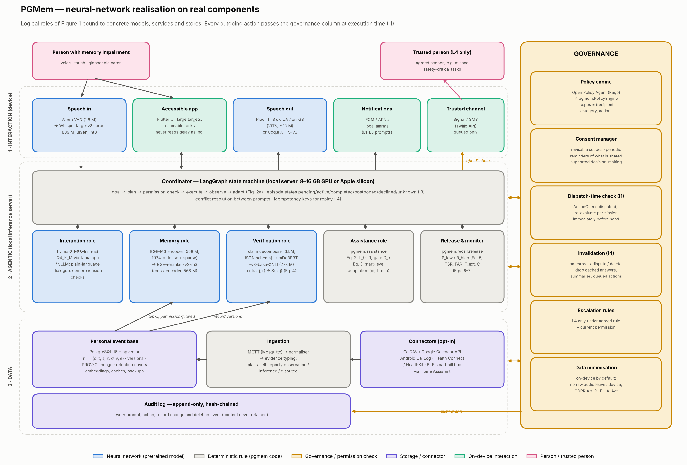
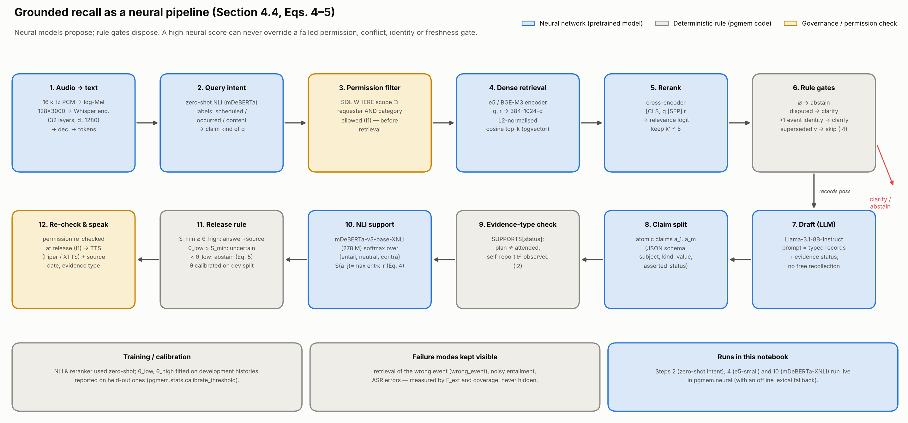

# pgmem — provenance-governed memory assistant

Reference implementation of the conceptual framework in
**"Provenance-governed agentic AI for personal knowledge and memory support: a framework and rule-level demonstration"**,
together with a synthetic dataset, metadata, statistical analysis of people with memory impairment, a
neural-network realisation on real components and a self-contained Google Colab notebook.

> ⚠️ **All data are synthetic.** No record corresponds to a real person. Distributions (age, MoCA, PRMQ, CDR, share
> living alone, etc.) are design assumptions for stage 1 of the paper's evaluation protocol (prototype on synthetic
> histories), not clinical estimates. Results show how the framework's rules behave and do not demonstrate benefit
> for people.

## Quick start — Google Colab

Open `notebooks/PGMem_Colab.ipynb` in Colab (File → Upload notebook) and run all cells (Runtime → Run all).
The package code is embedded in the notebook, so nothing else needs to be uploaded. For §9 (live neural models)
a T4 GPU runtime is recommended; CPU works too, and without internet the neural components fall back to a
labelled lexical scorer.

## What is implemented (mapping to the paper)

| Paper | Code |
|---|---|
| Eq. (1) record `r_i = (c, t, s, κ, σ, v, e)`, versions, disputed records, deletion with minimal audit | `pgmem/model.py` |
| Eq. (2) escalation with binary gate `G_k`; Eq. (3) lowering the starting level after `m` episodes | `pgmem/assistance.py` |
| Eq. (4) support score `S(a_j)`; Eq. (5) release rule (θ_low, θ_high) | `pgmem/recall.py` (`GroundedRecall`) |
| Consent, access roles, dispatch-time permission check, idempotency | `pgmem/governance.py` |
| Invariants I1–I4 and the six counterexamples of Table 3 | `tests/test_contract.py` |
| Eqs. (6)–(7) TSR, FPR/FAR, F_ext, C + independence, fabricated recollections per 100 answers, etc. | `pgmem/metrics.py`, `pgmem/stats.py` |
| Evaluation protocol (§6): three conditions on identical histories, strata, clustering | `pgmem/simulate.py` |
| Threshold calibration on development data, tested on held-out data (§4.4) | `pgmem/stats.py` (`risk_coverage`, `calibrate_threshold`) |
| Synthetic cohort and history generator | `pgmem/synth.py` |
| Dataset metadata (Frictionless Data Package) and validation | `pgmem/schema.py`, `data/datapackage.json` |
| **Neural-network realisation on real components** (architecture + recall-pipeline diagrams) | `pgmem/architecture.py` |
| **Live neural components**: mDeBERTa-XNLI for ent(a, r), zero-shot intent, e5 dense retrieval, end-to-end neural recall | `pgmem/neural.py` |
| Static figures (matplotlib) and interactive figures (Plotly) | `pgmem/plots.py`, `pgmem/interactive.py` |

## Neural-network solution on real components





| Role | Component | Params |
|---|---|---|
| Speech in | Silero VAD → Whisper large-v3-turbo | 1.8 M + 809 M |
| Speech out | Piper TTS (uk_UA / en_GB) or Coqui XTTS-v2 | ≈20 M / 467 M |
| Interaction role (LLM) | Llama-3.1-8B-Instruct Q4_K_M via llama.cpp / vLLM | 8 B |
| Memory role | BGE-M3 encoder + BGE-reranker-v2-m3 (notebook: multilingual-e5-small) | 568 M + 568 M (118 M) |
| Verification role, ent(a, r) | mDeBERTa-v3-base-xnli-multilingual-nli-2mil7 | 278 M |
| Assistance & release rules | `pgmem.assistance`, `pgmem.recall.release` | deterministic |
| Governance | Open Policy Agent (Rego) ⇄ `pgmem.PolicyEngine`, dispatch-time check | deterministic |
| Event base | PostgreSQL 16 + pgvector, PROV-O lineage, append-only audit | — |

Design rule: *neural models propose, rule gates dispose* — no entailment or similarity score can override a
failed permission (I1), evidence-type (I2), identity, conflict or freshness gate.

## Dataset (`data/`)

| File | Rows | Content |
|---|---|---|
| `participants.csv` | 240 | Participant metadata: age, sex, diagnosis (MCI / mild_dementia / ABI), CDR, MoCA, PRMQ-P/R, education, months since diagnosis, living situation, trusted person, device, digital literacy, sensors, call log, consents |
| `episodes.csv` | ≈17 000 | Scheduled tasks over 28 days (medication, walk, appointment preparation, bills, calls) |
| `records.csv` | ≈3 000 | Personal event base with evidence type, source, κ, consent scope, version |
| `questions.csv` | 4 320 | Questions about the past with strata: answerable, unrecorded, contradictory, stale, consent-restricted… |
| `reference_history.csv` | — | Independent reference history for scoring claims |
| `datapackage.json` | — | Description of every field: type, description, range, allowed values, provenance, seed |

## Running locally

```bash
pip install -r requirements.txt
python scripts/run_all.py            # generates data/, results/, reports/ (≈1 min)
python -m pytest -q tests            # 22 tests: equations, invariants, counterexamples, neural fallback
python scripts/build_notebook.py     # rebuild the Colab notebook
python scripts/execute_notebook.py notebooks/PGMem_Colab.ipynb   # optional: run it headless
```

Options: `--n 500 --days 56 --seed 7 --boot 1000`. To analyse your own (ethically approved, pseudonymised)
dataset with the same structure: `python scripts/run_all.py --data my_data --skip-generate`
(the data are first validated against `datapackage.json`).

## Results (seed 2026, 240 participants)

See `reports/summary.md`, figures `reports/*.png` and interactive views `reports/interactive/*.html`.

| Figure | What it shows |
|---|---|
| `fig1_cohort.png` | Cohort fingerprint: age ridgelines, MoCA × PRMQ landscape with density contours, metadata z-score strip |
| `fig2_radar.png` | Radar of all headline indicators, every axis oriented "outer = better", with bootstrap-CI bands |
| `fig2b_dots.png`, `fig2c_dots_recall.png` | Dot-and-whisker small multiples with 95 % CIs |
| `fig3_forest.png` | Forest plot of paired per-participant differences |
| `fig4_raincloud.png` | Raincloud plots of TSR by diagnosis × condition; independence vs MoCA |
| `fig5_recall_heatmap.png` | Recall strata × condition, with the violations hidden behind accuracy |
| `fig6_invariants.png` | Invariant scoreboard I1–I4 |
| `fig7_risk_coverage.png` | Risk–coverage curve of the release rule and calibrated threshold |
| `fig8_levels.png` | Diverging bars: independent vs assisted completions |
| `fig9_adaptation.png` | Starting-level adaptation (Eq. 3) and escalation load over time |
| `interactive/sankey_episodes.html` | Condition → true outcome → recorded state; red = completed task logged as missed |
| `interactive/sunburst_recall.html` | Condition → stratum → decision |
| `interactive/parallel_cohort.html` | Brushable parallel coordinates, metadata → outcome |
| `interactive/animated_weeks.html` | Week-by-week animated bubble chart |

In short:

* Proposed framework: **0** invented episode outcomes (I3), **0** contacts after consent withdrawal (I1),
  **0** fabricated recollections, **0** claims stronger than their evidence (I2); the lowest FPR.
* The baseline agent has a higher TSR, but reaches it by escalating despite postponement, contacting people
  without valid consent and turning silence into "missed". Under proposition P3 this is not counted as success.
* The framework's answer coverage is lower (≈0.62) because it abstains where records are missing or
  contradictory — the expected cost (§6: coverage is reported alongside F_ext).
* In the metadata, MoCA and PRMQ-prospective are most strongly associated with outcome; the mild-dementia group
  has the lowest TSR and independence — in the synthetic model this is built in by assumption, not discovered.

## Limitations

The model of human behaviour, prompt-response probabilities, support-scorer noise and failure rates are simulation
parameters (`pgmem/simulate.py`, `pgmem/synth.py`). The neural components in §9 are used zero-shot and are not
calibrated or validated for clinical use. Real conclusions require stages 2–4 of the protocol: co-design, a home
pilot and a comparative study with ethical approval.
