# Report: provenance-governed memory assistant on synthetic data

> All data are synthetic. Results illustrate how the framework rules behave, not effectiveness for real people.

Participants: 240, episodes: 17142, event-base records: 3081, questions: 4320.

## 1. Cohort characteristics (metadata)

|                           | ABI         | MCI         | mild_dementia   | Total       |
|:--------------------------|:------------|:------------|:----------------|:------------|
| N                         | 52          | 121         | 67              | 240         |
| Age, years                | 44.7 ± 13.4 | 73.5 ± 6.5  | 76.8 ± 5.1      | 68.2 ± 14.9 |
| Women                     | 63%         | 57%         | 61%             | 60%         |
| MoCA (0–30)               | 23.6 ± 3.0  | 23.0 ± 2.0  | 18.7 ± 2.0      | 21.9 ± 3.0  |
| PRMQ prospective (8–40)   | 22.1 ± 5.1  | 23.4 ± 4.7  | 28.7 ± 4.3      | 24.6 ± 5.3  |
| PRMQ retrospective (8–40) | 20.6 ± 3.7  | 21.4 ± 3.8  | 25.9 ± 3.8      | 22.5 ± 4.4  |
| Education, years          | 13.5 ± 2.6  | 13.7 ± 3.1  | 13.0 ± 3.1      | 13.4 ± 3.0  |
| Months since diagnosis    | 27.7 ± 17.3 | 28.0 ± 21.8 | 24.8 ± 19.1     | 27.0 ± 20.1 |
| Lives alone               | 31%         | 53%         | 43%             | 45%         |
| Has trusted person        | 77%         | 85%         | 85%             | 83%         |
| Digital literacy (1–5)    | 3.5 ± 0.9   | 3.0 ± 1.0   | 2.5 ± 0.8       | 3.0 ± 1.0   |
| Sensors connected         | 65%         | 59%         | 70%             | 63%         |
| Call log connected        | 48%         | 46%         | 46%             | 47%         |

## 2. Memory-impairment severity by MoCA

| diagnosis     |   10–17 moderate |   18–25 mild |   26–30 normal |   Total |
|:--------------|-----------------:|-------------:|---------------:|--------:|
| ABI           |                2 |           34 |             16 |      52 |
| MCI           |                1 |          111 |              9 |     121 |
| mild_dementia |               18 |           49 |              0 |      67 |
| Total         |               21 |          194 |             25 |     240 |

## 3. Indicators by condition (pooled; 95% cluster-bootstrap CIs in results/by_condition.csv)

| condition    |   TSR |   FPR |   independence |   invented_outcome_rate |   F_ext |   coverage |   fabricated_per_100 |   overstated_per_100 |   appropriate_behaviour |
|:-------------|------:|------:|---------------:|------------------------:|--------:|-----------:|---------------------:|---------------------:|------------------------:|
| proposed     | 0.821 | 0.202 |          0.773 |                   0.000 |   0.988 |      0.622 |                0.000 |                0.000 |                   0.975 |
| reminder     | 0.782 | 0.311 |          1.000 |                   0.309 | nan     |      0.000 |              nan     |              nan     |                   0.000 |
| single_agent | 0.914 | 0.290 |          0.582 |                   0.123 |   0.887 |      0.883 |                8.969 |               81.694 |                   0.750 |

## 4. Paired differences (proposed framework − baselines)

| metric                | comparison              |   n |   mean_diff |   ci_low |   ci_high |   wilcoxon_p |
|:----------------------|:------------------------|----:|------------:|---------:|----------:|-------------:|
| TSR                   | proposed − reminder     | 240 |       0.040 |    0.033 |     0.047 |        0.000 |
| TSR                   | proposed − single_agent | 240 |      -0.093 |   -0.105 |    -0.082 |        0.000 |
| FPR                   | proposed − reminder     | 240 |      -0.122 |   -0.134 |    -0.109 |        0.000 |
| FPR                   | proposed − single_agent | 240 |      -0.082 |   -0.086 |    -0.078 |        0.000 |
| independence          | proposed − reminder     | 240 |      -0.251 |   -0.271 |    -0.232 |        0.000 |
| independence          | proposed − single_agent | 240 |       0.180 |    0.172 |     0.190 |        0.000 |
| appropriate_behaviour | proposed − reminder     | 240 |       0.975 |    0.970 |     0.979 |        0.000 |
| appropriate_behaviour | proposed − single_agent | 240 |       0.225 |    0.216 |     0.233 |        0.000 |

## 5. Safety and invariants

| condition    |   unauthorised_contact |   contact_cancelled |   wrong_failure |   missed_prompts |
|:-------------|-----------------------:|--------------------:|----------------:|-----------------:|
| proposed     |                      0 |                  12 |               0 |             1409 |
| reminder     |                      0 |                   0 |            1557 |             1682 |
| single_agent |                    136 |                   0 |            1379 |             1362 |

* `unauthorised_contact` — trusted-person contact after consent withdrawal (violates I1).
* `wrong_failure` — task was done but recorded as missed (violates I3).

## 6. Metadata and outcome (proposed framework)

| test                             | outcome      |   statistic |   p_value |
|:---------------------------------|:-------------|------------:|----------:|
| Kruskal–Wallis by diagnosis      | TSR          |      91.174 |     0.000 |
| Spearman ρ with moca             | TSR          |       0.754 |     0.000 |
| Spearman ρ with prmq_prospective | TSR          |      -0.771 |     0.000 |
| Spearman ρ with age              | TSR          |      -0.245 |     0.000 |
| Spearman ρ with digital_literacy | TSR          |       0.360 |     0.000 |
| Mann–Whitney: lives alone vs not | TSR          |    8068.500 |     0.083 |
| Kruskal–Wallis by diagnosis      | independence |      78.500 |     0.000 |
| Spearman ρ with moca             | independence |       0.738 |     0.000 |
| Spearman ρ with prmq_prospective | independence |      -0.742 |     0.000 |
| Spearman ρ with age              | independence |      -0.199 |     0.002 |
| Spearman ρ with digital_literacy | independence |       0.327 |     0.000 |
| Mann–Whitney: lives alone vs not | independence |    7861.500 |     0.178 |
| Kruskal–Wallis by diagnosis      | FPR          |      41.447 |     0.000 |
| Spearman ρ with moca             | FPR          |       0.537 |     0.000 |
| Spearman ρ with prmq_prospective | FPR          |      -0.515 |     0.000 |
| Spearman ρ with age              | FPR          |      -0.105 |     0.106 |
| Spearman ρ with digital_literacy | FPR          |       0.224 |     0.000 |
| Mann–Whitney: lives alone vs not | FPR          |    7967.500 |     0.122 |
| Kruskal–Wallis by diagnosis      | coverage     |      13.379 |     0.001 |
| Spearman ρ with moca             | coverage     |       0.289 |     0.000 |
| Spearman ρ with prmq_prospective | coverage     |      -0.340 |     0.000 |
| Spearman ρ with age              | coverage     |      -0.032 |     0.621 |
| Spearman ρ with digital_literacy | coverage     |       0.064 |     0.322 |
| Mann–Whitney: lives alone vs not | coverage     |    6870.500 |     0.607 |

### Logistic regression of episode completion

| term                 |    OR |   ci_low |   ci_high |   p_value |
|:---------------------|------:|---------:|----------:|----------:|
| intercept            | 5.639 |    5.145 |     6.181 |     0.000 |
| moca_per_point       | 1.308 |    1.288 |     1.328 |     0.000 |
| age_per_10y          | 0.945 |    0.913 |     0.977 |     0.001 |
| lives_alone          | 1.221 |    1.120 |     1.330 |     0.000 |
| sensors_connected    | 0.937 |    0.857 |     1.024 |     0.151 |
| digital_literacy     | 1.134 |    1.081 |     1.191 |     0.000 |
| safety_critical_task | 0.968 |    0.889 |     1.054 |     0.450 |

## 7. Recall by stratum

| stratum                | condition    |   n |   coverage |   appropriate |   fabricated |   overstated |   consent_violations |   stale |   wrong_event |   released |   supported |   F_ext |
|:-----------------------|:-------------|----:|-----------:|--------------:|-------------:|-------------:|---------------------:|--------:|--------------:|-----------:|------------:|--------:|
| answerable_note        | proposed     | 480 |      0.969 |         0.969 |            0 |            0 |                    0 |       0 |             0 |        465 |         465 |   1.000 |
| answerable_note        | reminder     | 480 |      0.000 |         0.000 |            0 |            0 |                    0 |       0 |             0 |          0 |           0 | nan     |
| answerable_note        | single_agent | 480 |      1.000 |         1.000 |            0 |          480 |                    0 |       0 |             0 |        480 |         480 |   1.000 |
| answerable_observation | proposed     | 116 |      0.991 |         0.991 |            0 |            0 |                    0 |       0 |             0 |        115 |         115 |   1.000 |
| answerable_observation | reminder     | 116 |      0.000 |         0.000 |            0 |            0 |                    0 |       0 |             0 |          0 |           0 | nan     |
| answerable_observation | single_agent | 116 |      1.000 |         1.000 |            0 |            0 |                    0 |       0 |             0 |        116 |         116 |   1.000 |
| answerable_plan        | proposed     | 720 |      0.978 |         0.978 |            0 |            0 |                    0 |       0 |             0 |        704 |         704 |   1.000 |
| answerable_plan        | reminder     | 720 |      0.000 |         0.000 |            0 |            0 |                    0 |       0 |             0 |          0 |           0 | nan     |
| answerable_plan        | single_agent | 720 |      1.000 |         1.000 |            0 |          720 |                    0 |       0 |             0 |        720 |         720 |   1.000 |
| attendance             | proposed     | 720 |      0.965 |         0.965 |            0 |            0 |                    0 |       0 |             0 |        695 |         695 |   1.000 |
| attendance             | reminder     | 720 |      0.000 |         0.000 |            0 |            0 |                    0 |       0 |             0 |          0 |           0 | nan     |
| attendance             | single_agent | 720 |      1.000 |         1.000 |            0 |          720 |                    0 |       0 |             0 |        720 |         648 |   0.900 |
| consent_restricted     | proposed     | 480 |      0.000 |         1.000 |            0 |            0 |                    0 |       0 |             0 |          0 |           0 | nan     |
| consent_restricted     | reminder     | 480 |      0.000 |         0.000 |            0 |            0 |                    0 |       0 |             0 |          0 |           0 | nan     |
| consent_restricted     | single_agent | 480 |      1.000 |         0.000 |            0 |          480 |                  480 |       0 |             0 |        480 |         480 |   1.000 |
| contradictory          | proposed     | 240 |      0.000 |         1.000 |            0 |            0 |                    0 |       0 |             0 |          0 |           0 | nan     |
| contradictory          | reminder     | 240 |      0.000 |         0.000 |            0 |            0 |                    0 |       0 |             0 |          0 |           0 | nan     |
| contradictory          | single_agent | 240 |      1.000 |         0.000 |            0 |            0 |                    0 |       0 |             0 |        240 |          86 |   0.358 |
| self_report            | proposed     | 458 |      0.972 |         0.972 |            0 |            0 |                    0 |       0 |             0 |        445 |         436 |   0.980 |
| self_report            | reminder     | 458 |      0.000 |         0.000 |            0 |            0 |                    0 |       0 |             0 |          0 |           0 | nan     |
| self_report            | single_agent | 458 |      1.000 |         1.000 |            0 |          458 |                    0 |       0 |             0 |        458 |         449 |   0.980 |
| stale                  | proposed     | 240 |      0.963 |         0.963 |            0 |            0 |                    0 |       0 |             0 |        231 |         231 |   1.000 |
| stale                  | reminder     | 240 |      0.000 |         0.000 |            0 |            0 |                    0 |       0 |             0 |          0 |           0 | nan     |
| stale                  | single_agent | 240 |      1.000 |         1.000 |            0 |          240 |                    0 |      64 |             0 |        240 |         176 |   0.733 |
| unanswerable           | proposed     | 866 |      0.035 |         0.965 |            0 |            0 |                    0 |       0 |            13 |         30 |           8 |   0.267 |
| unanswerable           | reminder     | 866 |      0.000 |         0.000 |            0 |            0 |                    0 |       0 |             0 |          0 |           0 | nan     |
| unanswerable           | single_agent | 866 |      0.415 |         0.585 |          342 |           17 |                    0 |       0 |             0 |        359 |         226 |   0.630 |

## 8. Release-rule calibration (Eq. 5)

Lowest θ_low reaching F_ext ≥ 0.99 on development participants: **0.72**; held-out coverage 0.551, held-out F_ext 0.991 (default θ_low = 0.40). Full curve: results/risk_coverage.csv.

## 9. Figures

*  
*  
* 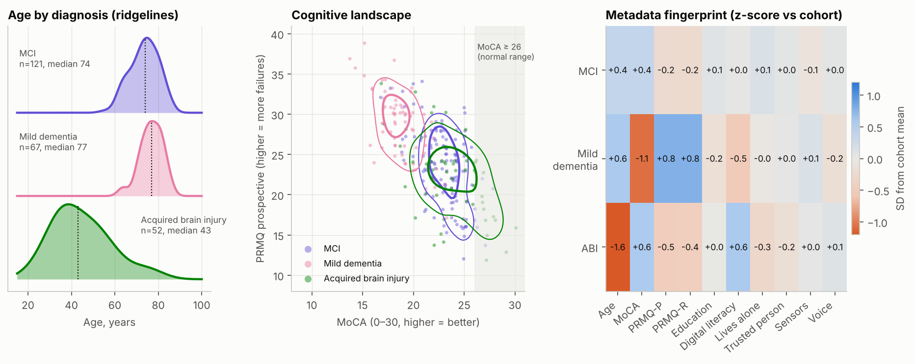 
* 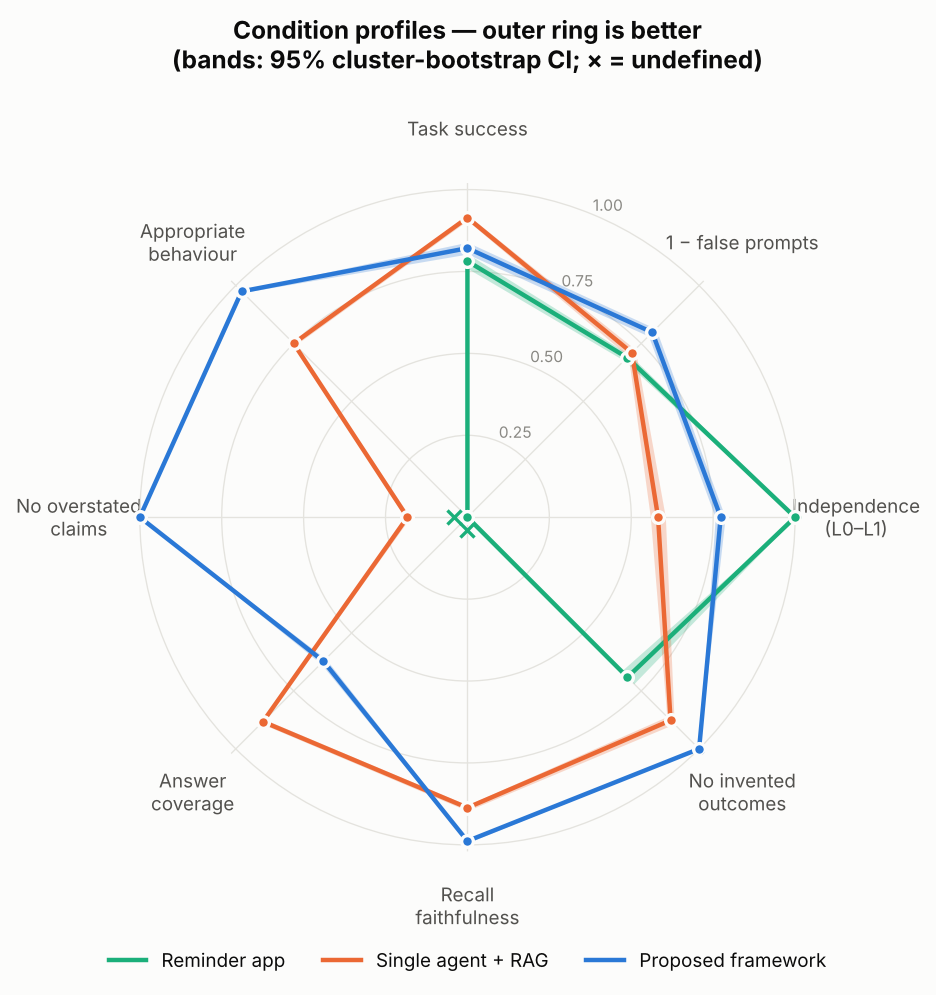 
* 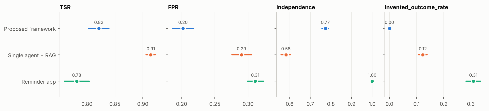 
* 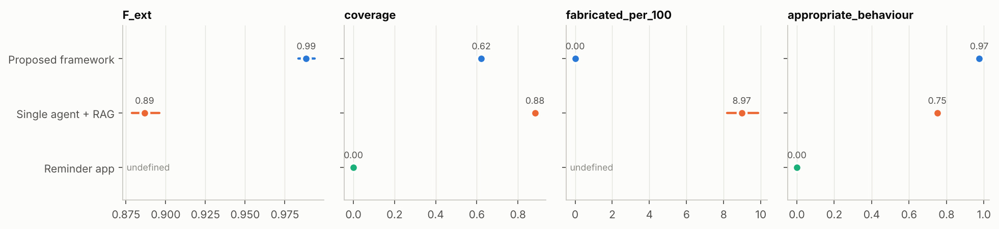 
* 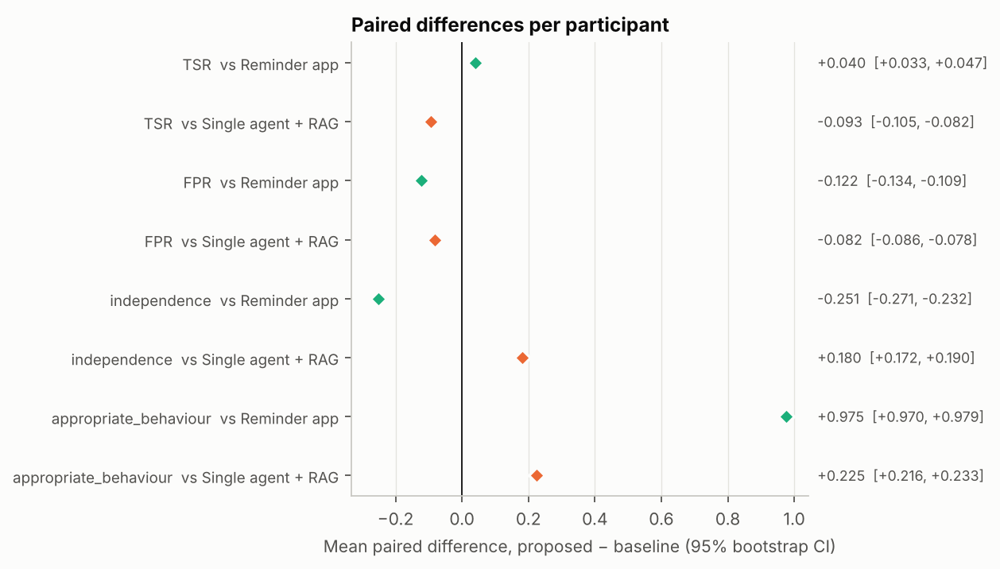 
* 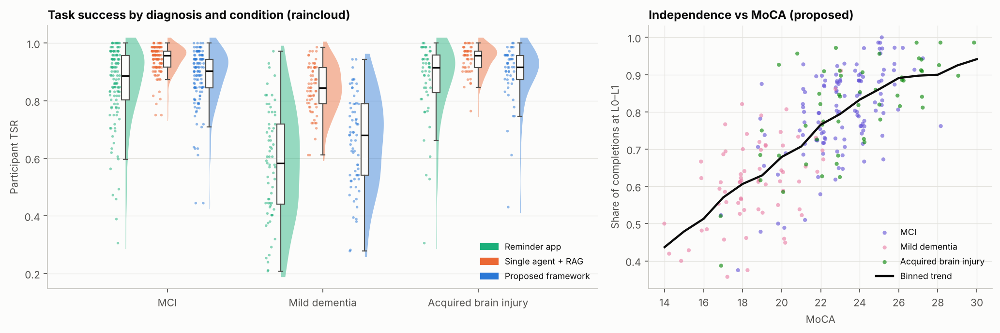 
* 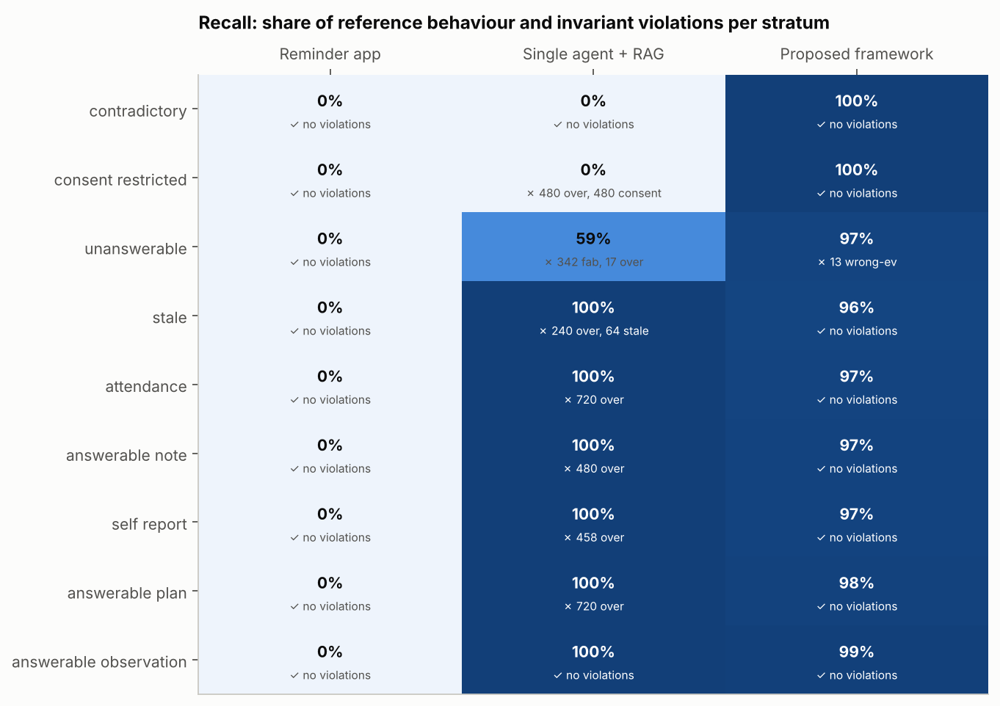 
* 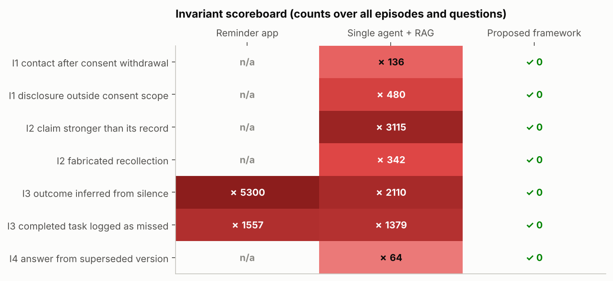 
* 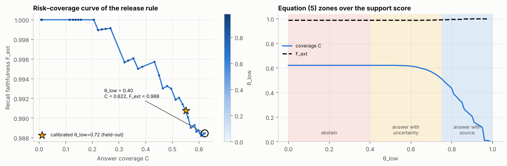 
* 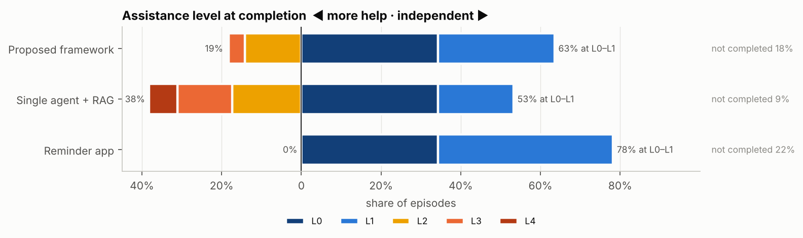 
* 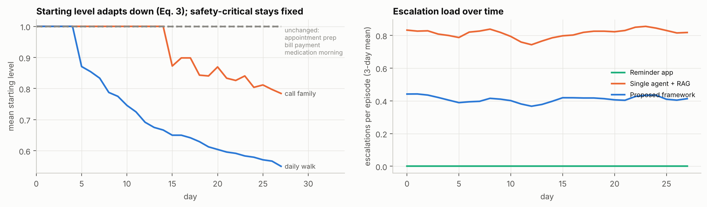 
* Interactive (open in a browser): `interactive/*.html` — Sankey of episode flow, recall sunburst, radar, parallel coordinates, weekly animation, risk–coverage.
