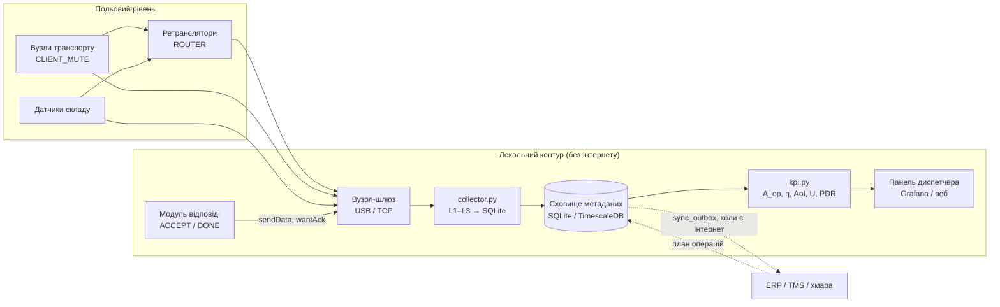

# Програмні рішення для збору метаданих Meshtastic у логістиці МСП

**Проєктний документ до програмного забезпечення [54] рукопису «Strengthening Operational Autonomy in Small and Medium-Sized Enterprise Logistics with Meshtastic Mesh Networks: Reference Architecture and Ex-Ante Model-Based Assessment» (logistics-4699826)**
Дата: 30.10.2026, переглянуто 28.11.2026 (версія 1.1.0)

> **Статус доказів.** Це проєктна пропозиція з прототипом коду. Експерименту не проводили. Програму **жодного разу не під'єднували до радіообладнання Meshtastic**; її запускали лише на вигаданому журналі, згенерованому `make_replay.py`. Жодне число, отримане цим пакетом, не є вимірюванням і не підтверджує значень статті, які є модельними прогнозами ex ante. Усе, що нижче сказано про «вимірювання», описує, що *буде* вимірюватися в польовому експерименті (розділ 4.6 і таблиця 9 статті), а не те, що вже виміряно.

---

## 1. Мета і межі

**Мета.** Описати програмний шар, який збирає технічні та логістичні метадані мережі Meshtastic і на їх основі обчислює польові відповідники показників, які стаття прогнозує моделлю. Мета — зафіксувати правила обліку **до** будь-яких вимірювань, щоб майбутній польовий експеримент міг перевірити модельні прогнози. Сам експеримент ще не проведено.

Стаття є модельним дослідженням, і цей пакет цього не змінює. Він лише визначає, як кожен ключовий показник можна буде виміряти:

| Показник у статті | Що потрібно виміряти | Джерело метаданих |
|---|---|---|
| Завантаження каналу *U*, шпаруватість ретранслятора | `channelUtilization`, `airUtilTx` з телеметрії вузлів | L2 |
| Імовірність доставки *p*, кількість хопів *h* | унікальні пакети за джерелом; `hopStart − hopLimit` | L1 |
| Свіжість даних (AoI) | часові мітки прийому позицій на шлюзі | L1, L2 |
| Покриття маршрутів | позиція + SNR/RSSI + хопи, прив'язані до маршруту | L1, L2, L4 |
| Операційна автономність *A*ₒₚ | заплановані критичні операції та їх своєчасне виконання | L3 + план із TMS/ERP |
| Дієвість *η* (рівняння 4; правило вимірювання — таблиця 9) | частка доставлених критичних подій, виконаних вчасно; це **верхня межа** *η*, бо вчасне виконання ще не доводить, що втрати уникнуто | L3 |
| Частка уникнених втрат *q* | базовий облік втрат до і з проєктом (програма його **не** збирає); програма дає лише зважену за втратами частку вчасно виконаних операцій — верхню межу *q* | облік + L3 |
| Профіль сервісу, NRI (розділ 2.7 статті) | вікна відмов зв'язку та живлення + виконання операцій | L3 + реєстр відмов |

**Межі.** Meshtastic лишається додатковим каналом для коротких критичних повідомлень і не замінює TMS/ERP чи мобільний зв'язок. Увесь контур працює **локально, без Інтернету**: синхронізація з корпоративними системами необов'язкова й відкладена (store-and-forward).

---

## 2. Чотири рівні метаданих

### L1 — пакет (радіорівень)
Збирається з кожного прийнятого пакета на шлюзі.

| Поле | Опис | Навіщо |
|---|---|---|
| `gw_rx_ts` | час прийому за годинником шлюзу | **єдиний довірений час** (вузли без GNSS можуть не мати точного часу) |
| `id`, `from`, `to`, `channel` | ідентифікатор пакета, відправник, адресат, канал | дедуплікація, доставка за джерелом |
| `portnum` | тип даних (POSITION_APP, TELEMETRY_APP, PRIVATE_APP …) | маршрутизація обробки |
| `rxSnr`, `rxRssi` | якість прийому | карта покриття, діагностика антен |
| `hopLimit`, `hopStart` | залишок і початок ліміту хопів → `hops_taken` | *h* у моделі доставки |
| `viaMqtt` | чи пакет прийшов через MQTT | виключити з радіостатистики |
| `is_duplicate` | повторна копія флуду (той самий `from`+`id` за 10 хв) | накладні витрати флуду, коректна PDR. **Застереження:** штатна прошивка відкидає вже бачені пакети до клієнтського API, тож на реальному шлюзі лічильник може бути нульовим; не перевірено на обладнанні |

### L2 — стан пристрою
| Поле | Джерело | Навіщо |
|---|---|---|
| `batteryLevel`, `voltage` | deviceMetrics | автономність живлення ретрансляторів |
| `channelUtilization` | deviceMetrics | *U*, перевірка межі 25 % |
| `airUtilTx` | deviceMetrics | власний ефірний час, перевірка обмеження шпаруватості |
| `uptimeSeconds` | deviceMetrics | перезавантаження, відмови живлення |
| позиція, `time`, `satsInView`, `precisionBits` | position | маршрути, вік даних, якість фіксації |
| `temperature` | environmentMetrics | холодовий ланцюг (якщо є датчик) |

### L3 — логістична подія та її життєвий цикл
Власний компактний протокол поверх PRIVATE_APP (порт 256), див. розділ 4.

| Поле | Опис |
|---|---|
| `event_id` | 6-байтовий випадковий ідентифікатор; однаковий для EVENT/ACCEPT/DONE |
| `operation_id` | зв'язок із рядком маршрутного листа / операцією TMS |
| `event_code`, `priority`, `value` | тип (відхилення температури, затримка, передача вантажу…), пріоритет, значення |
| `t_created`, `t_rx_gw`, `t_accept`, `t_done` | часова лінія: створено → отримано → прийнято → виконано |
| `deadline_ts`, `status` | крайній строк і стан (RECEIVED/ACCEPTED/DONE/REJECTED) |

**Отримання пакета ≠ виконання операції.** Тому три стани зберігаються окремо, і лише `DONE` до `deadline_ts` вважається успіхом.

### L4 — контекст і конфігурація
Реєстр вузлів (роль, тип активу, прошивка, пресет, регіон, антена), план критичних операцій на зміну (знаменник *A*ₒₚ, очікувана втрата в разі невиконання), реєстр відмов (Інтернет, мобільний зв'язок, електроживлення, ретранслятор). Без L4 неможливо відтворити жоден вимір, тому версії прошивок і налаштування фіксуються **до** випробувань.

---

## 3. Архітектура програмного рішення



**Компоненти**

| Компонент | Технологія | Призначення |
|---|---|---|
| Вузол-шлюз | Meshtastic-вузол, підключений до міні-ПК (USB/serial або TCP) | прийом усіх пакетів мережі |
| Колектор | Python 3.11+, `meshtastic` (перевірено 2.7.11), `pypubsub` | підписка на `meshtastic.receive`, розбір L1–L3, запис у БД |
| Сховище | SQLite (WAL) для пілота; PostgreSQL/TimescaleDB для кількох складів | журнал подій, метрики, реєстри |
| Розрахунок KPI | Python/SQL (`kpi.py`) | польові відповідники показників статті (польових даних поки немає) |
| Панель | Grafana з локальним джерелом даних або легкий веб-інтерфейс (**не реалізовано в цьому пакеті**) | п'ять візуалізацій (розділ 7) |
| Модуль відповіді | той самий колектор: `sendData(..., portNum=256, wantAck=True)` | ACCEPT/DONE від диспетчера |
| Синхронізація | шаблон outbox → REST/MQTT до ERP після відновлення зв'язку (реалізовано лише чергу `sync_outbox`, відправника немає) | ідемпотентне перенесення подій |

**Альтернативний шлях прийому.** Модуль MQTT Meshtastic може публікувати пакети на **локальний** брокер (наприклад, Mosquitto у мережі складу) замість хмарного. Це зручно для кількох шлюзів, але потребує Wi-Fi/Ethernet на вузлі-шлюзі, і доступні опції (зокрема JSON-вивід) треба перевірити для конкретного обладнання та прошивки. Для пілота простіший і надійніший прямий USB/TCP-колектор.

**Живлення.** Міні-ПК, вузол-шлюз і комутатор живляться від ДБЖ, розрахованого на очікувану тривалість відмови мережі. За модельним прогнозом статті (не за вимірюванням) 12 год — мінімум для тривалих відмов.

---

## 4. Протокол логістичних повідомлень

Текстові повідомлення зручні людям, але погано придатні для автоматичного обліку. Тому пропонується **бінарний кадр 24 байти** на порті PRIVATE_APP (256). Той самий зміст у JSON займає 135 байтів; за формулою часу в ефірі це у 2,4–2,8 раза більше ефірного часу (розрахунок, не вимірювання; див. блокнот, розділ 2).

| Байти | Поле | Примітка |
|---|---|---|
| 1 | версія | зараз 1 |
| 1 | тип | 1 EVENT · 2 ACCEPT · 3 DONE · 4 REJECT · 5 HEARTBEAT |
| 6 | event_id | випадковий; повтор того самого id — ідемпотентний |
| 4 | operation_id | рядок маршрутного листа / операція TMS |
| 1 | event_code | 1 відхилення температури, 2 відкриття дверей, 3 затримка, 4 запит зміни маршруту, 5 доставку виконано, 6 інцидент, 7 завантаження завершено, 8 передача вантажу |
| 1 | пріоритет | 0…3 |
| 4 | t_created | Unix-час відправника (0, якщо часу немає) |
| 2 | value | зі знаком, масштабоване (температура ×10, хвилини затримки) |
| 2 | deadline_min | строк виконання, хв |
| 2 | CRC-16/CCITT | захист від пошкодження та некоректних кадрів |

Правила:
- критичні події надсилаються з `wantAck=True`, а відповідь диспетчера ACCEPT/DONE повертається з тим самим `event_id`;
- дублікати флуду відкидаються за (`from`, `id`), а повтори подій — за `event_id`;
- за час отримання береться `gw_rx_ts`; крайній строк відлічується від `t_created` (тож радіозатримка не «пробачається»), і лише якщо годинник вузла не встановлено — від `gw_rx_ts`, про що `kpi.py` попереджає;
- бізнес-повідомлення передаються на **окремому приватному каналі** з власним ключем, а не на каналі за замовчуванням.

---

## 5. Схема сховища метаданих

SQLite для пілота. Чинна схема — у файлі `schema.sql` (версія схеми 2, колектор 1.1.0); у цьому документі її більше не дубльовано, щоб текст не розходився з кодом. Таблиці: `collector_session` (походження даних кожного запуску), `rx_packet` (L1), `node_metric` і `position` (L2), `logi_event` і `logi_event_log` (L3), `node_registry`, `planned_operation`, `outage` (L4), `sync_outbox`.

Три речі, які слід знати про схему:
- `collector_session.data_origin` набуває значень `synthetic`, `recorded_live`, `live_radio` або `unlabelled`. Саме за цим полем `kpi.py` вирішує, чи можна назвати результат вимірюванням.
- `planned_operation.loss_if_failed` — **припущена** аналітиком втрата в разі невиконання операції, в одній валюті для всіх рядків (у статті — постійні євро). Програма цю величину не вимірює.
- `outage` заповнюється вручну; `sync_outbox` лише накопичує записи — відправника до ERP/TMS у цьому релізі немає.

---

## 6. Програмний код

Код — у файлах пакета; лістинги з версії 1.0.0 цього документа вилучено, бо вони застаріли б після кожної зміни.

| Файл | Призначення |
|---|---|
| `logi_proto.py` | кодек 24-байтних кадрів, CRC-16/CCITT |
| `collector.py` | колектор L1–L3; реєструє походження даних кожного запуску |
| `kpi.py` | показники з блоком походження, розмірами вибірок і 95 % інтервалами |
| `import_plan.py` | імпорт плану критичних операцій (знаменник *A*ₒₚ) |
| `make_replay.py` | генератор вигаданого журналу для перевірки програми |

Залежності: для режиму відтворення, `kpi.py` і тестів — лише стандартна бібліотека Python; для роботи з радіо — `pip install meshtastic` (режим **не перевірено на обладнанні**).

### 6.1. Перевірка без радіообладнання

Скрипт `make_replay.py` генерує **вигаданий** журнал: 3 машини, 6 годин; кожну позицію відкинуто з імовірністю 0,15, обраною вручну; SNR і RSSI — рівномірні випадкові числа без моделі поширення; один запис телеметрії ретранслятора з константами 4,2 % і 1,3 %, уписаними вручну поблизу модельних прогнозів статті (3,92 % і 1,31 %); 4 критичні події із заданими в скрипті наслідками (дві вчасно, одна із запізненням, одна не виконана).

```bash
python make_replay.py
python collector.py --replay packets.jsonl --db test.db
python import_plan.py --db test.db --plan ops.json --loss 1000
python kpi.py --db test.db --from 1800000000 --to 1800021600
```

Еталонний вихід — у `examples/expected_kpi_synthetic.json`. Він починається з блоку `provenance` з `"is_measurement": false` і текстом «NOT A MEASUREMENT». Збіг з еталоном означає лише, що код детермінований. Самі числа є властивостями генератора: наприклад, `channel_util_max_pct` = 4,2 — це константа зі скрипта, а `A_op` = 0,5 випливає з того, що скрипт завершує вчасно дві події з чотирьох (95 % інтервал 0,15–0,85). **Жодне з цих чисел нічого не підтверджує в моделі статті.**

Тести (`python -m unittest discover -s tests`) перевіряють правила обліку: дублікати не є доставкою; прийняття не є виконанням; виконання після строку та радіозатримка не зараховуються як успіх; операція без жодного повідомлення лишається у знаменнику; за порожнього плану *A*ₒₚ невизначена, а не нульова; файл відтворення не може оголосити себе даними з радіо; згенеровані чи непозначені дані ніколи не подаються як вимірювання.

---

## 7. Від метаданих до візуалізацій

| Візуалізація зі статті | Дані зі сховища | Рішення |
|---|---|---|
| Карта економічної вразливості маршрутів | `position` + `rx_packet` (SNR, хопи) + `planned_operation.loss_if_failed`; свіжість за AoI | де ставити ретранслятор; ділянки без даних показуються як «невідомо» |
| Площина «вартість — автономність» | `A_op` за пілотними конфігураціями + TCO з обліку | яку конфігурацію купувати |
| Каскадна діаграма ефекту | уникнені втрати за категоріями з базового обліку (не з цієї програми), витрати на підтримку | який механізм дає ефект; контроль подвійного обліку |
| Профіль втрати й відновлення сервісу | `outage` + `logi_event.t_done` у часі | скільки резервного живлення; що відновлювати першим |
| Карта порогів доцільності | виміряні *A*ₒₚ, *η*, *L* у моделі NPV | чи проходить пілот поріг *q*\* |

Приклад запиту для панелі «свіжість позицій» (Grafana, джерело SQLite/PostgreSQL):

```sql
SELECT r.asset_ref, r.asset_type,
       ROUND((strftime('%s','now') - MAX(p.gw_rx_ts)) / 60.0, 1) AS age_min,
       CASE WHEN (strftime('%s','now') - MAX(p.gw_rx_ts)) > 1800 THEN 'STALE' ELSE 'OK' END AS state
FROM position p JOIN node_registry r ON r.node = p.node
GROUP BY p.node ORDER BY age_min DESC;
```

---

## 8. Якість даних і правила обліку

1. **Час.** Довіряти лише `gw_rx_ts`, а годинник шлюзу синхронізувати через GNSS-модуль або локальний NTP-сервер, оскільки під час відмови Інтернету зовнішній NTP недоступний.
2. **Знаменник.** Перелік критичних операцій, строки й критерії успіху фіксуються **до** зміни. Операції, які Meshtastic не підтримує, лишаються у знаменнику *A*ₒₚ, а за нульового знаменника показник вважається невизначеним.
3. **Дублікати.** Копії флуду (`is_duplicate=1`) враховуються лише як накладні витрати мережі, а не як доставка.
4. **Розділення ефектів.** Вплив нового каналу і вплив нової панелі оцінюються окремо (порівняльний експеримент із диспетчерами).
5. **Конфігурація.** Кожна зміна прошивки, пресету, антени чи ролі вузла записується в `node_registry`, а виміри до і після зміни не змішуються.
6. **Зберігання.** Сирі `rx_packet` зберігаються 90 днів, агрегати та `logi_event` — на весь строк пілота. Це пропозиція, і її треба узгодити з внутрішньою політикою.

## 9. Безпека та персональні дані

- Окремий приватний канал зі своїм ключем, регулярна зміна ключів, контроль доступу до вузла-шлюзу та міні-ПК.
- Шифрування каналу не захищає від глушіння, повторного відтворення кадрів чи скомпрометованого пристрою. Тому протокол містить CRC і `event_id`, а журнал `logi_event_log` є лише доповнюваним (append-only), щоб зберігався аудиторський слід.
- **Позиція транспорту з прив'язкою до водія — це персональні дані.** У реєстрі використовуються псевдонімізовані `asset_ref` (без ПІБ), строки зберігання позицій обмежуються, а обробка має відповідати Закону України «Про захист персональних даних» і внутрішнім положенням підприємства. Правову оцінку варто погодити з юристом.
- Під час синхронізації з ERP передаються лише агреговані або потрібні для обліку поля. Сирі радіометадані лишаються в локальному контурі.

## 10. План упровадження

| Етап | Зміст | Результат | Орієнтовна трудомісткість ¹ |
|---|---|---|---|
| 0. Підготовка | перевірка дозволених частот і потужності для місця пілота; вибір обладнання; фіксація прошивки та пресету | паспорт конфігурації | 3–5 днів |
| 1. Базовий облік | без Meshtastic: збір даних про збої, простої, втрати вантажу, маржу | базові *L*₁, *L*₂ | 4–8 тижнів (паралельно) |
| 2. Розгортання колектора | шлюз, `collector.py`, БД, реєстр вузлів, імпорт плану операцій | працюючий журнал L1–L4 | 1–2 тижні |
| 3. Протокол подій | інтеграція кнопок/форм водія та диспетчера з кадром PRIVATE_APP; ACCEPT/DONE | життєвий цикл подій | 2–3 тижні |
| 4. Контрольовані сценарії | відмова Інтернету, вузла, живлення; навантаження; виїзд із зони | виміряні *U*, *p*, AoI, *A*ₒₚ | 2–4 тижні |
| 5. Панелі та експеримент | п'ять візуалізацій; порівняння з базовою панеллю | час і якість рішень | 2–3 тижні |
| 6. Економічна перевірка | заміна умовних чисел у моделі NPV виміряними | висновок щодо порогу *q*\* і *η*\* | 1 тиждень |

¹ Орієнтир для одного розробника й одного технічного фахівця; уточнюється після етапу 0.

## 11. Ризики та обмеження

- **Програму не запускали на радіообладнанні.** Режими `--serial` і `--tcp` написано за документованим API `meshtastic` 2.7.11 і не виконано жодного разу; перевірено лише режим відтворення вигаданого журналу. API бібліотеки й формат пакетів змінюються між версіями, тож перед пілотом потрібен тест на реальному обладнанні.
- Із дев'яти величин таблиці 9 статті колектор реєструє три повністю (*U* і час в ефірі ретранслятора, *A*ₒₚ, *η* за правилом таблиці 9), три частково (доставка критичних подій, доставка позицій і AoI, дальність і покриття) і три не реєструє (рівень ручних процедур, рівень резерву через другого оператора, час роботи диспетчерської сторони на резервному живленні).
- Дублікати флуду можуть бути невидимими через клієнтський API реальної прошивки (див. L1).
- Поля `hopStart`, `rxRssi`, `precisionBits` можуть бути відсутні у старих прошивках, тому колектор зберігає NULL і не відкидає пакет.
- Модуль Store & Forward та JSON-вивід через MQTT залежать від апаратної платформи. Їх можна використати як доповнення, але не як основу.
- Колектор на одному шлюзі бачить лише те, що доходить до нього. Для кількох складів потрібні кілька колекторів зі спільним сховищем або локальний MQTT-брокер.

## 12. Джерела

- Meshtastic Python library — API (pubsub-теми, інтерфейси): https://python.meshtastic.org/
- Meshtastic Python CLI/library docs: https://meshtastic.org/docs/development/python/library/
- Meshtastic LoRa Configuration (регіони, шпаруватість, ліміт хопів): https://meshtastic.org/docs/configuration/radio/lora/
- Meshtastic Radio Settings (пресети): https://meshtastic.org/docs/overview/radio-settings/
- Meshtastic MQTT / Telemetry / Encryption: https://meshtastic.org/docs/configuration/module/mqtt/ · https://meshtastic.org/docs/configuration/module/telemetry/ · https://meshtastic.org/docs/overview/encryption/
- Kaul, S.; Yates, R.; Gruteser, M. Real-Time Status: How Often Should One Update? IEEE INFOCOM 2012. https://doi.org/10.1109/INFCOM.2012.6195689
- Cho, H. et al. Quantifying Cyber Resilience… *Electronics* 2025, 14, 2465. https://doi.org/10.3390/electronics14122465
