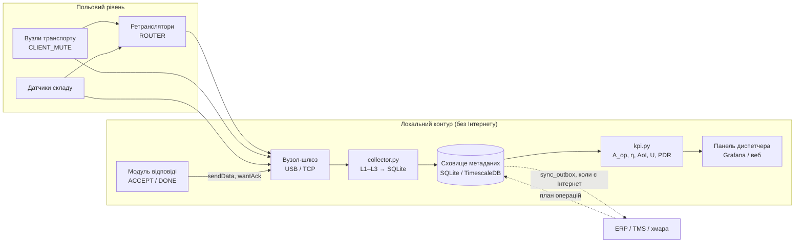

# Програмні рішення для збору метаданих Meshtastic у логістиці МСП

**Пропозиція до проєкту «Strengthening Economic Autonomy in SME Logistics with Meshtastic»**
Дата: 30.10.2026 · Статус: проєктна пропозиція з робочим прототипом коду (перевірено на синтетичних даних, без радіообладнання)

---

## 1. Мета і межі

**Мета.** Описати програмний шар, який збирає технічні та логістичні метадані мережі Meshtastic і на їх основі обчислює показники зі статті. Тоді польовий пілот замінить умовні припущення моделі виміряними значеннями.

Без такого шару стаття лишається моделлю. З ним кожен ключовий показник можна виміряти:

| Показник у статті | Що потрібно виміряти | Джерело метаданих |
|---|---|---|
| Завантаження каналу *U*, шпаруватість ретранслятора | `channelUtilization`, `airUtilTx` з телеметрії вузлів | L2 |
| Імовірність доставки *p*, кількість хопів *h* | унікальні пакети за джерелом; `hopStart − hopLimit` | L1 |
| Свіжість даних (AoI) | часові мітки прийому позицій на шлюзі | L1, L2 |
| Покриття маршрутів | позиція + SNR/RSSI + хопи, прив'язані до маршруту | L1, L2, L4 |
| Операційна автономність *A*ₒₚ | заплановані критичні операції та їх своєчасне виконання | L3 + план із TMS/ERP |
| Дієвість *η* (рівняння 9) | частка доставлених подій, виконаних вчасно | L3 |
| Зниження втрат *R*ₗₒₛₛ, частка *q* | вартість невиконаних операцій до і з проєктом | L3 + облік |
| Профіль сервісу, NRI (рівняння 10) | вікна відмов зв'язку та живлення + виконання операцій | L3 + реєстр відмов |

**Межі.** Meshtastic лишається додатковим каналом для коротких критичних повідомлень і не замінює TMS/ERP чи мобільний зв'язок. Увесь контур працює **локально, без Інтернету**: синхронізація з корпоративними системами необов'язкова й відкладена (store-and-forward).

---

## 2. Чотири рівні метаданих

### L1 — пакет (радіорівень)
Збирається з кожного прийнятого пакета на шлюзі.

| Поле | Опис | Навіщо |
|---|---|---|
| `gw_rx_ts` | час прийому за годинником шлюзу | **єдиний довірений час** (вузли без GNSS можуть не мати точного часу) |
| `id`, `from`, `to`, `channel` | ідентифікатор пакета, відправник, адресат, канал | дедуплікація, доставка за джерелом |
| `portnum` | тип даних (POSITION_APP, TELEMETRY_APP, PRIVATE_APP …) | маршрутизація обробки |
| `rxSnr`, `rxRssi` | якість прийому | карта покриття, діагностика антен |
| `hopLimit`, `hopStart` | залишок і початок ліміту хопів → `hops_taken` | *h* у моделі доставки |
| `viaMqtt` | чи пакет прийшов через MQTT | виключити з радіостатистики |
| `is_duplicate` | повторна копія флуду (той самий `from`+`id` за 10 хв) | накладні витрати флуду, коректна PDR |

### L2 — стан пристрою
| Поле | Джерело | Навіщо |
|---|---|---|
| `batteryLevel`, `voltage` | deviceMetrics | автономність живлення ретрансляторів |
| `channelUtilization` | deviceMetrics | *U*, перевірка межі 25 % |
| `airUtilTx` | deviceMetrics | власний ефірний час, перевірка обмеження шпаруватості |
| `uptimeSeconds` | deviceMetrics | перезавантаження, відмови живлення |
| позиція, `time`, `satsInView`, `precisionBits` | position | маршрути, вік даних, якість фіксації |
| `temperature` | environmentMetrics | холодовий ланцюг (якщо є датчик) |

### L3 — логістична подія та її життєвий цикл
Власний компактний протокол поверх PRIVATE_APP (порт 256), див. розділ 4.

| Поле | Опис |
|---|---|
| `event_id` | 6-байтовий випадковий ідентифікатор; однаковий для EVENT/ACCEPT/DONE |
| `operation_id` | зв'язок із рядком маршрутного листа / операцією TMS |
| `event_code`, `priority`, `value` | тип (відхилення температури, затримка, передача вантажу…), пріоритет, значення |
| `t_created`, `t_rx_gw`, `t_accept`, `t_done` | часова лінія: створено → отримано → прийнято → виконано |
| `deadline_ts`, `status` | крайній строк і стан (RECEIVED/ACCEPTED/DONE/REJECTED/EXPIRED) |

**Отримання пакета ≠ виконання операції.** Тому три стани зберігаються окремо, і лише `DONE` до `deadline_ts` вважається успіхом.

### L4 — контекст і конфігурація
Реєстр вузлів (роль, тип активу, прошивка, пресет, регіон, антена), план критичних операцій на зміну (знаменник *A*ₒₚ, очікувана втрата в разі невиконання), реєстр відмов (Інтернет, мобільний зв'язок, електроживлення, ретранслятор). Без L4 неможливо відтворити жоден вимір, тому версії прошивок і налаштування фіксуються **до** випробувань.

---

## 3. Архітектура програмного рішення



**Компоненти**

| Компонент | Технологія | Призначення |
|---|---|---|
| Вузол-шлюз | Meshtastic-вузол, підключений до міні-ПК (USB/serial або TCP) | прийом усіх пакетів мережі |
| Колектор | Python 3.11+, `meshtastic` (перевірено 2.7.11), `pypubsub` | підписка на `meshtastic.receive`, розбір L1–L3, запис у БД |
| Сховище | SQLite (WAL) для пілота; PostgreSQL/TimescaleDB для кількох складів | журнал подій, метрики, реєстри |
| Розрахунок KPI | Python/SQL (`kpi.py`) | показники статті з польових даних |
| Панель | Grafana з локальним джерелом даних або легкий веб-інтерфейс | п'ять візуалізацій (розділ 7) |
| Модуль відповіді | той самий колектор: `sendData(..., portNum=256, wantAck=True)` | ACCEPT/DONE від диспетчера |
| Синхронізація | шаблон outbox → REST/MQTT до ERP після відновлення зв'язку | ідемпотентне перенесення подій |

**Альтернативний шлях прийому.** Модуль MQTT Meshtastic може публікувати пакети на **локальний** брокер (наприклад, Mosquitto у мережі складу) замість хмарного. Це зручно для кількох шлюзів, але потребує Wi-Fi/Ethernet на вузлі-шлюзі, і доступні опції (зокрема JSON-вивід) треба перевірити для конкретного обладнання та прошивки. Для пілота простіший і надійніший прямий USB/TCP-колектор.

**Живлення.** Міні-ПК, вузол-шлюз і комутатор живляться від ДБЖ, розрахованого на очікувану тривалість відмови мережі. За результатами моделі 12 год — мінімум для тривалих відмов.

---

## 4. Протокол логістичних повідомлень

Текстові повідомлення зручні людям, але погано придатні для автоматичного обліку. Тому пропонується **бінарний кадр 24 байти** на порті PRIVATE_APP (256). Це втричі менше за типовий JSON, отже менше ефірного часу і менше колізій.

| Байти | Поле | Примітка |
|---|---|---|
| 1 | версія | зараз 1 |
| 1 | тип | 1 EVENT · 2 ACCEPT · 3 DONE · 4 REJECT · 5 HEARTBEAT |
| 6 | event_id | випадковий; повтор того самого id — ідемпотентний |
| 4 | operation_id | рядок маршрутного листа / операція TMS |
| 1 | event_code | 1 відхилення температури, 2 відкриття дверей, 3 затримка, 4 запит зміни маршруту, 5 доставку виконано, 6 інцидент, 7 завантаження завершено, 8 передача вантажу |
| 1 | пріоритет | 0…3 |
| 4 | t_created | Unix-час відправника (0, якщо часу немає) |
| 2 | value | зі знаком, масштабоване (температура ×10, хвилини затримки) |
| 2 | deadline_min | строк виконання, хв |
| 2 | CRC-16/CCITT | захист від пошкодження та некоректних кадрів |

Правила:
- критичні події надсилаються з `wantAck=True`, а відповідь диспетчера ACCEPT/DONE повертається з тим самим `event_id`;
- дублікати флуду відкидаються за (`from`, `id`), а повтори подій — за `event_id`;
- за час події береться `gw_rx_ts`; `t_created` використовується лише для оцінки затримки, якщо годинник вузла синхронізований (GNSS);
- бізнес-повідомлення передаються на **окремому приватному каналі** з власним ключем, а не на каналі за замовчуванням.

---

## 5. Схема сховища метаданих

SQLite для пілота. Схема без змін (окрім синтаксису автоінкременту) переноситься на PostgreSQL/TimescaleDB, де `gw_rx_ts` стає гіпертаблицею за часом.

```sql
-- Metadata store for the Meshtastic logistics layer (SQLite >= 3.35; portable to PostgreSQL/TimescaleDB)
PRAGMA journal_mode = WAL;

-- L1. Every received radio packet (raw radio metadata)
CREATE TABLE IF NOT EXISTS rx_packet (
  rx_id        INTEGER PRIMARY KEY AUTOINCREMENT,
  gw_rx_ts     REAL    NOT NULL,          -- gateway clock, unix s (authoritative time)
  pkt_id       INTEGER,                   -- Meshtastic packet id
  from_node    INTEGER NOT NULL,
  to_node      INTEGER,
  channel      INTEGER,
  portnum      TEXT,
  rx_time      INTEGER,                   -- rxTime reported by the radio
  rx_snr       REAL,
  rx_rssi      INTEGER,
  hop_limit    INTEGER,
  hop_start    INTEGER,
  hops_taken   INTEGER,                   -- hop_start - hop_limit, NULL if unknown
  via_mqtt     INTEGER DEFAULT 0,
  payload_len  INTEGER,
  is_duplicate INTEGER DEFAULT 0,
  UNIQUE (from_node, pkt_id, gw_rx_ts)
);
CREATE INDEX IF NOT EXISTS ix_rx_from_ts ON rx_packet(from_node, gw_rx_ts);

-- L2. Node / device state (telemetry: battery, channel utilization, airtime)
CREATE TABLE IF NOT EXISTS node_metric (
  node         INTEGER NOT NULL,
  gw_rx_ts     REAL    NOT NULL,
  battery_pct  INTEGER,
  voltage      REAL,
  channel_util REAL,                      -- % (as reported by the node)
  air_util_tx  REAL,                      -- % of own airtime in the last hour
  uptime_s     INTEGER,
  temperature  REAL,                      -- environment sensor, if present
  PRIMARY KEY (node, gw_rx_ts)
);

CREATE TABLE IF NOT EXISTS position (
  node         INTEGER NOT NULL,
  gw_rx_ts     REAL    NOT NULL,
  lat          REAL, lon REAL, alt REAL,
  fix_time     INTEGER,                   -- GNSS time of fix
  sats         INTEGER,
  precision_bits INTEGER,
  rx_snr       REAL, hops_taken INTEGER,
  PRIMARY KEY (node, gw_rx_ts)
);

-- Node registry and configuration snapshot (L4 context)
CREATE TABLE IF NOT EXISTS node_registry (
  node         INTEGER PRIMARY KEY,
  node_id      TEXT, long_name TEXT, short_name TEXT, hw_model TEXT,
  role         TEXT,                      -- CLIENT_MUTE / ROUTER / CLIENT ...
  asset_type   TEXT,                      -- vehicle / relay / sensor / dispatcher / gateway
  asset_ref    TEXT,                      -- plate number, site code ... (pseudonymised)
  firmware     TEXT, modem_preset TEXT, region TEXT, antenna TEXT,
  first_seen   REAL, last_seen REAL
);

-- L3. Logistics events and their life cycle
CREATE TABLE IF NOT EXISTS logi_event (
  event_id     TEXT PRIMARY KEY,          -- hex of 6-byte id
  operation_id INTEGER NOT NULL,
  origin_node  INTEGER NOT NULL,
  event_code   INTEGER NOT NULL,
  priority     INTEGER,
  t_created    INTEGER,                   -- sender clock (may be 0)
  t_rx_gw      REAL NOT NULL,             -- first reception at gateway
  hops_taken   INTEGER,
  value        INTEGER,
  deadline_ts  REAL,                      -- t_rx_gw (or t_created) + deadline
  t_accept     REAL,                      -- dispatcher/driver accepted
  t_done       REAL,                      -- operation completed
  status       TEXT DEFAULT 'RECEIVED',   -- RECEIVED/ACCEPTED/DONE/REJECTED/EXPIRED
  outage_id    INTEGER                    -- link to outage window if any
);

CREATE TABLE IF NOT EXISTS logi_event_log (   -- append-only audit trail
  id INTEGER PRIMARY KEY AUTOINCREMENT,
  event_id TEXT, msg_type INTEGER, from_node INTEGER, gw_rx_ts REAL, rx_id INTEGER
);

-- Planned critical operations (denominator of A_op), filled from TMS/ERP before an outage or daily
CREATE TABLE IF NOT EXISTS planned_operation (
  operation_id INTEGER PRIMARY KEY,
  route_id     TEXT, vehicle_node INTEGER, cargo_class TEXT,
  critical     INTEGER DEFAULT 1,
  due_ts       REAL,                       -- deadline of the operation
  loss_if_failed_uah REAL                  -- expected loss if not completed on time
);

-- Outage windows of external connectivity and grid power (manual or from monitoring)
CREATE TABLE IF NOT EXISTS outage (
  outage_id INTEGER PRIMARY KEY AUTOINCREMENT,
  kind TEXT CHECK (kind IN ('INTERNET','CELLULAR','GRID_POWER','RELAY')),
  t_start REAL NOT NULL, t_end REAL, note TEXT
);

-- Outbox for synchronisation with ERP/cloud when Internet is back (store-and-forward)
CREATE TABLE IF NOT EXISTS sync_outbox (
  id INTEGER PRIMARY KEY AUTOINCREMENT,
  entity TEXT, entity_id TEXT, payload_json TEXT, created_ts REAL, sent_ts REAL
);
```

---

## 6. Програмний код

Чотири файли розміщуються в одному каталозі на шлюзі. Залежності: `pip install meshtastic` (вона тягне за собою `pypubsub`); для `kpi.py` потрібна лише стандартна бібліотека Python.

### 6.1. `logi_proto.py` — кодек логістичних кадрів

```python
"""Compact binary protocol for logistics events over Meshtastic PRIVATE_APP (portnum 256).

Frame layout (big-endian, 24 bytes, fits easily into one LoRa frame):
  B  version (=1)
  B  msg_type   1=EVENT 2=ACCEPT 3=DONE 4=REJECT 5=HEARTBEAT
  6s event_id   (random, unique per event; the same id is reused by ACCEPT/DONE)
  I  operation_id  (id of the logistics operation / waybill line in TMS/ERP)
  B  event_code    (see EVENT_CODES)
  B  priority      0..3 (3 = critical)
  I  t_created     unix time, s (sender clock; may be 0 if the node has no GNSS/time)
  h  value         signed, scaled (e.g. temperature x10, minutes of delay)
  H  deadline_min  minutes from t_created for completion (0 = none)
  H  crc16         CRC-16/CCITT over all preceding bytes
"""
import os, struct, time
from dataclasses import dataclass

FMT = ">BB6sIBBIhH"
HDR_LEN = struct.calcsize(FMT)  # 22
FRAME_LEN = HDR_LEN + 2         # 24
VERSION = 1
MSG_TYPES = {1: "EVENT", 2: "ACCEPT", 3: "DONE", 4: "REJECT", 5: "HEARTBEAT"}
EVENT_CODES = {
    1: "TEMP_EXCURSION", 2: "DOOR_OPEN", 3: "DELAY", 4: "ROUTE_CHANGE_REQ",
    5: "DELIVERY_DONE", 6: "INCIDENT", 7: "LOADING_DONE", 8: "HANDOVER",
}

def crc16_ccitt(data: bytes, crc: int = 0xFFFF) -> int:
    for b in data:
        crc ^= b << 8
        for _ in range(8):
            crc = ((crc << 1) ^ 0x1021) if crc & 0x8000 else (crc << 1)
            crc &= 0xFFFF
    return crc

@dataclass
class LogiMsg:
    msg_type: int
    event_id: bytes
    operation_id: int
    event_code: int
    priority: int = 3
    t_created: int = 0
    value: int = 0
    deadline_min: int = 0
    version: int = VERSION

    def encode(self) -> bytes:
        body = struct.pack(FMT, self.version, self.msg_type, self.event_id, self.operation_id,
                           self.event_code, self.priority, self.t_created, self.value, self.deadline_min)
        return body + struct.pack(">H", crc16_ccitt(body))

    @classmethod
    def decode(cls, raw: bytes) -> "LogiMsg":
        if len(raw) != FRAME_LEN:
            raise ValueError(f"bad length {len(raw)}")
        body, (crc,) = raw[:HDR_LEN], struct.unpack(">H", raw[HDR_LEN:])
        if crc16_ccitt(body) != crc:
            raise ValueError("crc mismatch")
        v, mt, eid, op, code, pr, tc, val, dl = struct.unpack(FMT, body)
        if v != VERSION:
            raise ValueError(f"unsupported version {v}")
        return cls(mt, eid, op, code, pr, tc, val, dl, v)

    @property
    def event_hex(self) -> str:
        return self.event_id.hex()

def new_event(operation_id: int, event_code: int, value: int = 0, deadline_min: int = 30, priority: int = 3) -> LogiMsg:
    return LogiMsg(1, os.urandom(6), operation_id, event_code, priority, int(time.time()), value, deadline_min)

def reply(ev: LogiMsg, msg_type: int) -> LogiMsg:
    """ACCEPT / DONE / REJECT for an existing event (same event_id)."""
    return LogiMsg(msg_type, ev.event_id, ev.operation_id, ev.event_code, ev.priority, int(time.time()), 0, 0)
```

### 6.2. `collector.py` — колектор метаданих L1–L3

```python
"""Metadata collector for a Meshtastic logistics gateway.

Runs on the local gateway (mini-PC / Raspberry Pi) connected to a Meshtastic node by USB or TCP.
Works without Internet; writes everything to a local SQLite database.

  python collector.py --serial /dev/ttyUSB0 --db logi.db
  python collector.py --tcp 192.168.1.50 --db logi.db
  python collector.py --replay packets.jsonl --db test.db     # offline test without a radio

Tested with meshtastic-python 2.7.11 (API: SerialInterface/TCPInterface, pubsub topic "meshtastic.receive",
MeshInterface.sendData(..., portNum=256, wantAck=True)).
"""
import argparse, json, sqlite3, time, logging
from pathlib import Path
from logi_proto import LogiMsg, MSG_TYPES

PRIVATE_APP = 256
DUP_WINDOW_S = 600
log = logging.getLogger("collector")

def _portnum(dec):
    p = dec.get("portnum")
    return {256: "PRIVATE_APP"}.get(p, str(p)) if p is not None else None

class Collector:
    def __init__(self, db_path, iface=None):
        self.db = sqlite3.connect(db_path, check_same_thread=False)
        self.db.executescript(Path(__file__).with_name("schema.sql").read_text())
        self.iface = iface          # needed only to send ACK replies

    # ---------- generic radio metadata (L1) ----------
    def handle(self, pkt, now=None):
        now = now or time.time()
        dec = pkt.get("decoded", {}) or {}
        frm = pkt.get("from"); pid = pkt.get("id")
        hl, hs = pkt.get("hopLimit"), pkt.get("hopStart")
        hops = (hs - hl) if (hs is not None and hl is not None) else None
        dup = self.db.execute("SELECT 1 FROM rx_packet WHERE from_node=? AND pkt_id=? AND gw_rx_ts>?",
                              (frm, pid, now - DUP_WINDOW_S)).fetchone() is not None
        payload = dec.get("payload") or b""
        cur = self.db.execute(
            "INSERT OR IGNORE INTO rx_packet(gw_rx_ts,pkt_id,from_node,to_node,channel,portnum,rx_time,rx_snr,rx_rssi,"
            "hop_limit,hop_start,hops_taken,via_mqtt,payload_len,is_duplicate) VALUES(?,?,?,?,?,?,?,?,?,?,?,?,?,?,?)",
            (now, pid, frm, pkt.get("to"), pkt.get("channel", 0), _portnum(dec), pkt.get("rxTime"), pkt.get("rxSnr"),
             pkt.get("rxRssi"), hl, hs, hops, int(bool(pkt.get("viaMqtt"))), len(payload), int(dup)))
        rx_id = cur.lastrowid
        self.db.execute("INSERT INTO node_registry(node,first_seen,last_seen) VALUES(?,?,?) "
                        "ON CONFLICT(node) DO UPDATE SET last_seen=excluded.last_seen", (frm, now, now))
        if not dup:
            port = _portnum(dec)
            if port == "TELEMETRY_APP":
                self._telemetry(frm, dec.get("telemetry", {}), now)
            elif port == "POSITION_APP":
                self._position(frm, dec.get("position", {}), pkt, hops, now)
            elif port == "PRIVATE_APP" and payload:
                self._logistics(frm, bytes(payload), hops, rx_id, now)
            elif port == "NODEINFO_APP":
                self._nodeinfo(frm, dec.get("user", {}))
        self.db.commit()

    # ---------- L2: device state ----------
    def _telemetry(self, node, tel, now):
        dm, em = tel.get("deviceMetrics", {}), tel.get("environmentMetrics", {})
        if not dm and not em:
            return
        self.db.execute("INSERT OR REPLACE INTO node_metric VALUES(?,?,?,?,?,?,?,?)",
                        (node, now, dm.get("batteryLevel"), dm.get("voltage"), dm.get("channelUtilization"),
                         dm.get("airUtilTx"), dm.get("uptimeSeconds"), em.get("temperature")))

    def _position(self, node, pos, pkt, hops, now):
        lat = pos.get("latitude", (pos.get("latitudeI") or 0) * 1e-7 or None)
        lon = pos.get("longitude", (pos.get("longitudeI") or 0) * 1e-7 or None)
        self.db.execute("INSERT OR REPLACE INTO position VALUES(?,?,?,?,?,?,?,?,?,?)",
                        (node, now, lat, lon, pos.get("altitude"), pos.get("time"), pos.get("satsInView"),
                         pos.get("precisionBits"), pkt.get("rxSnr"), hops))

    def _nodeinfo(self, node, user):
        self.db.execute("UPDATE node_registry SET node_id=?, long_name=?, short_name=?, hw_model=?, role=COALESCE(?,role) "
                        "WHERE node=?", (user.get("id"), user.get("longName"), user.get("shortName"),
                                         str(user.get("hwModel")), user.get("role"), node))

    # ---------- L3: logistics events ----------
    def _logistics(self, node, raw, hops, rx_id, now):
        try:
            m = LogiMsg.decode(raw)
        except ValueError as e:
            log.warning("bad logistics frame from %s: %s", node, e); return
        eid = m.event_hex
        self.db.execute("INSERT INTO logi_event_log(event_id,msg_type,from_node,gw_rx_ts,rx_id) VALUES(?,?,?,?,?)",
                        (eid, m.msg_type, node, now, rx_id))
        if m.msg_type == 1:  # EVENT
            dl = (now + 60 * m.deadline_min) if m.deadline_min else None
            self.db.execute("INSERT OR IGNORE INTO logi_event(event_id,operation_id,origin_node,event_code,priority,"
                            "t_created,t_rx_gw,hops_taken,value,deadline_ts) VALUES(?,?,?,?,?,?,?,?,?,?)",
                            (eid, m.operation_id, node, m.event_code, m.priority, m.t_created, now, hops, m.value, dl))
            self._outbox("logi_event", eid, {"op": m.operation_id, "code": m.event_code, "value": m.value}, now)
        elif m.msg_type in (2, 3, 4):
            col, st = {2: ("t_accept", "ACCEPTED"), 3: ("t_done", "DONE"), 4: ("t_done", "REJECTED")}[m.msg_type]
            self.db.execute(f"UPDATE logi_event SET {col}=COALESCE({col},?), status=? WHERE event_id=?", (now, st, eid))
            self._outbox("logi_event_state", eid, {"state": st}, now)

    def _outbox(self, entity, eid, data, now):
        self.db.execute("INSERT INTO sync_outbox(entity,entity_id,payload_json,created_ts) VALUES(?,?,?,?)",
                        (entity, eid, json.dumps(data), now))

    # ---------- dispatcher side: send ACCEPT/DONE back over the mesh ----------
    def send(self, msg: LogiMsg, dest="^all", channel_index=1):
        if self.iface is None:
            raise RuntimeError("no radio interface")
        self.iface.sendData(msg.encode(), destinationId=dest, portNum=PRIVATE_APP, wantAck=True,
                            channelIndex=channel_index)

def run_radio(args):
    from pubsub import pub
    import meshtastic.serial_interface, meshtastic.tcp_interface
    iface = (meshtastic.tcp_interface.TCPInterface(hostname=args.tcp) if args.tcp
             else meshtastic.serial_interface.SerialInterface(devPath=args.serial))
    col = Collector(args.db, iface)
    pub.subscribe(lambda packet, interface: col.handle(packet), "meshtastic.receive")
    log.info("collector running; Ctrl+C to stop")
    try:
        while True:
            time.sleep(1)
    finally:
        iface.close()

def run_replay(args):
    col = Collector(args.db)
    for line in open(args.replay):
        rec = json.loads(line)
        pkt = rec["packet"]
        if "payload_hex" in pkt.get("decoded", {}):
            pkt["decoded"]["payload"] = bytes.fromhex(pkt["decoded"].pop("payload_hex"))
        col.handle(pkt, now=rec["t"])

if __name__ == "__main__":
    ap = argparse.ArgumentParser()
    ap.add_argument("--serial"); ap.add_argument("--tcp"); ap.add_argument("--replay")
    ap.add_argument("--db", default="logi.db")
    a = ap.parse_args()
    logging.basicConfig(level=logging.INFO)
    run_replay(a) if a.replay else run_radio(a)
```

### 6.3. `kpi.py` — показники статті з польових даних

```python
"""KPI calculation from the metadata store (links the field data to the paper's model).

  python kpi.py --db logi.db --from 1730000000 --to 1730086400
"""
import argparse, sqlite3, json, math

def kpis(db, t0, t1, aoi_stale_min=30):
    q = lambda sql, *p: db.execute(sql, p).fetchall()
    out = {}
    # Radio: delivery of unique packets per source, hops, link quality
    r = q("""SELECT COUNT(*), SUM(is_duplicate), AVG(rx_snr), AVG(hops_taken)
             FROM rx_packet WHERE gw_rx_ts BETWEEN ? AND ?""", t0, t1)[0]
    out["rx_total"], out["rx_duplicates"] = r[0], r[1] or 0
    out["flood_overhead"] = round((r[1] or 0) / max(r[0] - (r[1] or 0), 1), 3)   # rebroadcast copies per unique packet
    out["snr_mean_db"], out["hops_mean"] = r[2], r[3]
    # Channel utilization U as reported by nodes (mean of max per node)
    u = q("""SELECT node, MAX(channel_util), MAX(air_util_tx) FROM node_metric
             WHERE gw_rx_ts BETWEEN ? AND ? GROUP BY node""", t0, t1)
    out["channel_util_max_pct"] = max([x[1] or 0 for x in u], default=None)
    out["relay_airtime_max_pct"] = max([x[2] or 0 for x in u], default=None)
    # Position delivery ratio p (expected reports per vehicle vs received) and age of information
    pos = q("""SELECT node, COUNT(*), MAX(gw_rx_ts) FROM position WHERE gw_rx_ts BETWEEN ? AND ? GROUP BY node""", t0, t1)
    interval = 600.0
    exp_n = max((t1 - t0) / interval, 1)
    out["position_delivery_ratio"] = {n: round(min(c / exp_n, 1.0), 3) for n, c, _ in pos}
    out["stale_nodes"] = [n for n, _, last in pos if (t1 - last) / 60 > aoi_stale_min]
    # AoI: time-average age from consecutive receptions
    aoi = {}
    for n, *_ in pos:
        ts = [x[0] for x in q("SELECT gw_rx_ts FROM position WHERE node=? AND gw_rx_ts BETWEEN ? AND ? ORDER BY 1", n, t0, t1)]
        if len(ts) >= 2:
            area = sum((b - a) ** 2 / 2 for a, b in zip(ts, ts[1:]))
            aoi[n] = round(area / (ts[-1] - ts[0]) / 60, 2)
    out["aoi_mean_min"] = aoi
    # Logistics events: latency, acceptance, completion
    ev = q("""SELECT event_id, t_created, t_rx_gw, t_accept, t_done, deadline_ts, status FROM logi_event
              WHERE t_rx_gw BETWEEN ? AND ?""", t0, t1)
    n = len(ev)
    lat = [e[2] - e[1] for e in ev if e[1]]
    out["events"] = n
    out["event_latency_median_s"] = sorted(lat)[len(lat) // 2] if lat else None
    acc = [e for e in ev if e[3]]
    done_ok = [e for e in ev if e[4] and (e[5] is None or e[4] <= e[5]) and e[6] == "DONE"]
    out["accept_ratio"] = round(len(acc) / n, 3) if n else None
    # eta = completed on time / delivered critical messages  (Equation (9) of the paper)
    out["eta_actionability"] = round(len(done_ok) / n, 3) if n else None
    # A_op = critical planned operations completed on time / all planned in window (denominator never shrinks)
    plan = q("""SELECT p.operation_id, p.due_ts, p.loss_if_failed_uah,
                       (SELECT MIN(t_done) FROM logi_event e WHERE e.operation_id=p.operation_id AND e.status='DONE')
                FROM planned_operation p WHERE p.critical=1 AND p.due_ts BETWEEN ? AND ?""", t0, t1)
    if plan:
        ok = [p for p in plan if p[3] is not None and p[3] <= p[1]]
        out["A_op"] = round(len(ok) / len(plan), 3)
        base = sum(p[2] or 0 for p in plan)
        out["R_loss"] = round(sum(p[2] or 0 for p in ok) / base, 3) if base else None
    else:
        out["A_op"] = None  # undefined: zero denominator
    return out

if __name__ == "__main__":
    ap = argparse.ArgumentParser()
    ap.add_argument("--db", default="logi.db"); ap.add_argument("--from", dest="t0", type=float, required=True)
    ap.add_argument("--to", dest="t1", type=float, required=True)
    a = ap.parse_args()
    print(json.dumps(kpis(sqlite3.connect(a.db), a.t0, a.t1), indent=1, default=str))
```

### 6.4. Перевірка без радіообладнання

Скрипт `make_replay.py` генерує синтетичний журнал: 3 машини, 6 годин, приблизно 15 % втрат позицій, копії флуду, телеметрію ретранслятора і 4 критичні події, з яких одна виконана із запізненням, а одна не виконана. Колектор обробляє цей журнал у режимі `--replay`.

```bash
python make_replay.py
python collector.py --replay packets.jsonl --db test.db
python kpi.py --db test.db --from 1800000000 --to 1800021600   # після імпорту плану операцій
```

Результат тестового прогону (синтетичні дані, **не** виміри):

```json
{"rx_total": 128, "rx_duplicates": 27, "flood_overhead": 0.267, "hops_mean": 1.47,
 "channel_util_max_pct": 4.2, "relay_airtime_max_pct": 1.3,
 "position_delivery_ratio": {"11": 0.75, "12": 0.889, "13": 0.833},
 "aoi_mean_min": {"11": 7.65, "12": 6.14, "13": 7.57},
 "events": 4, "accept_ratio": 1.0, "eta_actionability": 0.5, "A_op": 0.5, "R_loss": 0.5}
```

Тест перевіряє такі властивості: дублікати флуду відокремлюються від доставки; стан події змінюється від RECEIVED через ACCEPTED до DONE; виконання після строку не зараховується в *η* і *A*ₒₚ; пошкоджений кадр відкидається за CRC; кожна подія потрапляє в `sync_outbox` для подальшої синхронізації.

```python
import json, random
from logi_proto import new_event, reply
random.seed(1); T0=1_800_000_000; out=[]
pid=1000
def pk(t, frm, port, dec, hops=1, dup=False):
    global pid
    if not dup: pid+=1
    out.append({"t":t,"packet":{"from":frm,"to":4294967295,"id":pid,"rxSnr":round(random.uniform(-12,8),1),"rxRssi":random.randint(-120,-80),
      "hopLimit":3-hops,"hopStart":3,"rxTime":int(t),"decoded":dict(portnum=port, **dec)}})
for v in (11,12,13):
    for k in range(0,36):
        t=T0+k*600+v
        if random.random()<0.85:
            pk(t,v,"POSITION_APP",{"position":{"latitudeI":484500000+k*100,"longitudeI":350400000,"satsInView":9,"time":int(t)}},hops=random.choice([1,2]))
            if random.random()<0.3: pk(t+2,v,"POSITION_APP",{"position":{"latitudeI":1,"longitudeI":1}},dup=True)
pk(T0+50,21,"TELEMETRY_APP",{"telemetry":{"deviceMetrics":{"batteryLevel":87,"voltage":4.01,"channelUtilization":4.2,"airUtilTx":1.3,"uptimeSeconds":3600}}})
ops=[]
for i,op in enumerate([501,502,503,504]):
    ev=new_event(op,1,value=85,deadline_min=30); ev.t_created=T0+1000*i+100
    pk(T0+1000*i+101,11,256,{"payload_hex":ev.encode().hex()},hops=2)
    pk(T0+1000*i+160,1,256,{"payload_hex":reply(ev,2).encode().hex()})
    if i<3: pk(T0+1000*i+900 if i<2 else T0+1000*i+2500,11,256,{"payload_hex":reply(ev,3).encode().hex()},hops=2)
    ops.append((op,T0+1000*i+100+1800))
json.dump(ops,open("ops.json","w"))
with open("packets.jsonl","w") as f:
    for r in out: f.write(json.dumps(r)+"\n")
print(len(out))
```

---

## 7. Від метаданих до візуалізацій

| Візуалізація зі статті | Дані зі сховища | Рішення |
|---|---|---|
| Карта економічної вразливості маршрутів | `position` + `rx_packet` (SNR, хопи) + `planned_operation.loss_if_failed_uah`; свіжість за AoI | де ставити ретранслятор; ділянки без даних показуються як «невідомо» |
| Площина «вартість — автономність» | `A_op` за пілотними конфігураціями + TCO з обліку | яку конфігурацію купувати |
| Каскадна діаграма ефекту | `R_loss` за категоріями втрат, витрати на підтримку | який механізм дає ефект; контроль подвійного обліку |
| Профіль втрати й відновлення сервісу | `outage` + `logi_event.t_done` у часі | скільки резервного живлення; що відновлювати першим |
| Карта порогів доцільності | виміряні *A*ₒₚ, *η*, *L* у моделі NPV | чи проходить пілот поріг *q*\* |

Приклад запиту для панелі «свіжість позицій» (Grafana, джерело SQLite/PostgreSQL):

```sql
SELECT r.asset_ref, r.asset_type,
       ROUND((strftime('%s','now') - MAX(p.gw_rx_ts)) / 60.0, 1) AS age_min,
       CASE WHEN (strftime('%s','now') - MAX(p.gw_rx_ts)) > 1800 THEN 'STALE' ELSE 'OK' END AS state
FROM position p JOIN node_registry r ON r.node = p.node
GROUP BY p.node ORDER BY age_min DESC;
```

---

## 8. Якість даних і правила обліку

1. **Час.** Довіряти лише `gw_rx_ts`, а годинник шлюзу синхронізувати через GNSS-модуль або локальний NTP-сервер, оскільки під час відмови Інтернету зовнішній NTP недоступний.
2. **Знаменник.** Перелік критичних операцій, строки й критерії успіху фіксуються **до** зміни. Операції, які Meshtastic не підтримує, лишаються у знаменнику *A*ₒₚ, а за нульового знаменника показник вважається невизначеним.
3. **Дублікати.** Копії флуду (`is_duplicate=1`) враховуються лише як накладні витрати мережі, а не як доставка.
4. **Розділення ефектів.** Вплив нового каналу і вплив нової панелі оцінюються окремо (порівняльний експеримент із диспетчерами).
5. **Конфігурація.** Кожна зміна прошивки, пресету, антени чи ролі вузла записується в `node_registry`, а виміри до і після зміни не змішуються.
6. **Зберігання.** Сирі `rx_packet` зберігаються 90 днів, агрегати та `logi_event` — на весь строк пілота. Це пропозиція, і її треба узгодити з внутрішньою політикою.

## 9. Безпека та персональні дані

- Окремий приватний канал зі своїм ключем, регулярна зміна ключів, контроль доступу до вузла-шлюзу та міні-ПК.
- Шифрування каналу не захищає від глушіння, повторного відтворення кадрів чи скомпрометованого пристрою. Тому протокол містить CRC і `event_id`, а журнал `logi_event_log` є лише доповнюваним (append-only), щоб зберігався аудиторський слід.
- **Позиція транспорту з прив'язкою до водія — це персональні дані.** У реєстрі використовуються псевдонімізовані `asset_ref` (без ПІБ), строки зберігання позицій обмежуються, а обробка має відповідати Закону України «Про захист персональних даних» і внутрішнім положенням підприємства. Правову оцінку варто погодити з юристом.
- Під час синхронізації з ERP передаються лише агреговані або потрібні для обліку поля. Сирі радіометадані лишаються в локальному контурі.

## 10. План упровадження

| Етап | Зміст | Результат | Орієнтовна трудомісткість ¹ |
|---|---|---|---|
| 0. Підготовка | перевірка дозволених частот і потужності для місця пілота; вибір обладнання; фіксація прошивки та пресету | паспорт конфігурації | 3–5 днів |
| 1. Базовий облік | без Meshtastic: збір даних про збої, простої, втрати вантажу, маржу | базові *L*₁, *L*₂ | 4–8 тижнів (паралельно) |
| 2. Розгортання колектора | шлюз, `collector.py`, БД, реєстр вузлів, імпорт плану операцій | працюючий журнал L1–L4 | 1–2 тижні |
| 3. Протокол подій | інтеграція кнопок/форм водія та диспетчера з кадром PRIVATE_APP; ACCEPT/DONE | життєвий цикл подій | 2–3 тижні |
| 4. Контрольовані сценарії | відмова Інтернету, вузла, живлення; навантаження; виїзд із зони | виміряні *U*, *p*, AoI, *A*ₒₚ | 2–4 тижні |
| 5. Панелі та експеримент | п'ять візуалізацій; порівняння з базовою панеллю | час і якість рішень | 2–3 тижні |
| 6. Економічна перевірка | заміна умовних чисел у моделі NPV виміряними | висновок щодо порогу *q*\* і *η*\* | 1 тиждень |

¹ Орієнтир для одного розробника й одного технічного фахівця; уточнюється після етапу 0.

## 11. Ризики та обмеження

- API бібліотеки `meshtastic` і формат пакетів змінюються між версіями. Код перевірено з `meshtastic` 2.7.11 на синтетичному відтворенні; перед пілотом потрібен тест на реальному обладнанні.
- Поля `hopStart`, `rxRssi`, `precisionBits` можуть бути відсутні у старих прошивках, тому колектор зберігає NULL і не відкидає пакет.
- Модуль Store & Forward та JSON-вивід через MQTT залежать від апаратної платформи. Їх можна використати як доповнення, але не як основу.
- Колектор на одному шлюзі бачить лише те, що доходить до нього. Для кількох складів потрібні кілька колекторів зі спільним сховищем або локальний MQTT-брокер.

## 12. Джерела

- Meshtastic Python library — API (pubsub-теми, інтерфейси): https://python.meshtastic.org/
- Meshtastic Python CLI/library docs: https://meshtastic.org/docs/development/python/library/
- Meshtastic LoRa Configuration (регіони, шпаруватість, ліміт хопів): https://meshtastic.org/docs/configuration/radio/lora/
- Meshtastic Radio Settings (пресети): https://meshtastic.org/docs/overview/radio-settings/
- Meshtastic MQTT / Telemetry / Encryption: https://meshtastic.org/docs/configuration/module/mqtt/ · https://meshtastic.org/docs/configuration/module/telemetry/ · https://meshtastic.org/docs/overview/encryption/
- Kaul, S.; Yates, R.; Gruteser, M. Real-Time Status: How Often Should One Update? IEEE INFOCOM 2012. https://doi.org/10.1109/INFCOM.2012.6195689
- Cho, H. et al. Quantifying Cyber Resilience… *Electronics* 2025, 14, 2465. https://doi.org/10.3390/electronics14122465
